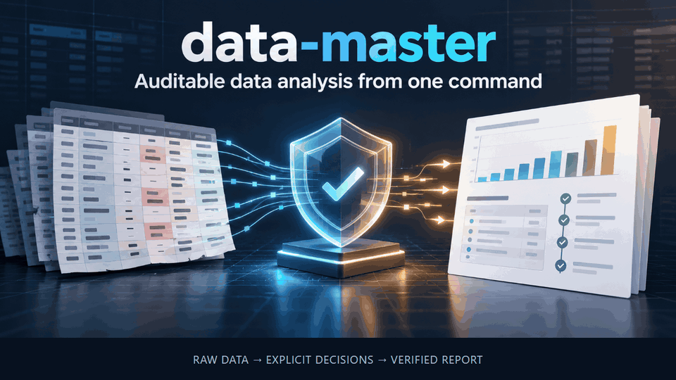

# data-master

**Turn a messy dataset into an auditable PDF report from one command.**

[](https://github.com/MAGA2010/data-master/actions/workflows/ci.yml)
[](https://github.com/MAGA2010/data-master/releases)
[](https://github.com/MAGA2010/data-master/stargazers)
[](https://www.python.org/)
[](LICENSE)
[](SKILL.md)

[中文](README.zh-CN.md) · [Examples](#reproducible-case-studies) · [Evaluation](EVALUATION.md) · [Roadmap](ROADMAP.md) · [Launch kit](docs/LAUNCH_KIT.md)



`data-master` preserves the raw input, makes every cleaning decision explicit,
runs statistics only at the level the data supports, tests sensitivity, and
delivers Markdown, PDF and machine-readable evidence. It is a Codex skill and a
standalone cross-platform CLI.

## Try it

Requires Node.js 20+ and Python 3.11+.

```bash
npm install -g github:MAGA2010/data-master#v0.3.0
data-master setup
data-master skill install
data-master demo --out outputs/first-demo
```

Open `outputs/first-demo/report.pdf`, then inspect the verdict in
`outputs/first-demo/audit/final_audit.md`.

If the verified demo is useful, [star the repository](https://github.com/MAGA2010/data-master) so other researchers and analysts can find it.

The npm package has no install hooks and no JavaScript dependencies. `setup` is
the only command that downloads Python dependencies; it creates an isolated
environment. `skill install` atomically installs the bundled skill and refuses
to overwrite an existing copy.

## Why use it

| A plausible analysis can fail when… | data-master records or prevents it by… |
|---|---|
| `02134` silently becomes `2134` | Reading delimited cells as text until an explicit conversion is approved |
| Repeated rows inflate the sample size | Declaring the independent unit and moving the primary analysis to that level |
| Cleaning alters an unrelated column | Comparing untouched columns with the raw input in text space |
| A p-value appears without context | Saving the test, n, df, effect size, interval and correction family |
| “Robust” means one convenient re-fit | Running saved leave-one-group-out, jackknife, fence and complete-case perturbations |
| A polished report hides an unresolved decision | Producing the report and a separate audit that can still refuse submission |
| A resumed run reuses changed evidence | Hashing stage artifacts, code, references, dependencies and run options |

The audit enforces reporting discipline. It does not replace statistical
judgment, collection context, peer review or a study protocol.

## What you receive

```text
outputs/
|-- report.pdf                     primary human-readable report
|-- report.md                      citable report source
|-- report.html                    self-contained shareable export of report.md
|-- executive_summary.md
|-- state.json                     stage ledger and provenance
|-- answers.template.json          decisions that require a human
|-- analysis/
|   |-- profile.json
|   |-- descriptive.json
|   |-- inferential.json
|   `-- sensitivity.json
|-- cleaned/
|   |-- cleaned.csv
|   |-- clean_<dataset>.py         replayable cleaning program
|   `-- validation.json
|-- charts/
`-- audit/
    |-- final_audit.md
    `-- final_audit.json
```

Verify a delivered run without modifying it:

```bash
data-master verify outputs/first-demo --json
```

## Analyze your data

```bash
data-master analyze measurements.csv \
  --out outputs/study \
  --group treatment \
  --unit-key participant_id \
  --outcomes response_time,accuracy
```

Resume interrupted work:

```bash
data-master resume outputs/study/state.json
```

If a conversion or study decision is unsafe to infer, the run writes
`answers.template.json`. Fill its stable decision IDs and resume with:

```bash
data-master resume outputs/study/state.json --answers outputs/study/answers.json
```

Use `data-master analyze --help` for all pipeline options, including declared
covariates, journal/checklist routing, input-size limits, lockfile export and PDF
backend selection.

## Reproducible case studies

| Case | Failure being tested | Evidence |
|---|---|---|
| [Identifier traps](docs/case-studies/identifier-traps.md) | Leading zeros, dates, currency and mixed values are silently retyped | Plan, replay and untouched-column validation |
| [Date or number?](docs/case-studies/identifier-traps.md#benchmark-date-or-number) | `20240115` is an integer and a date; the file does not say which | `coerce_numeric_or_date` hold with evidence and an answers-file resolution |
| [Synthetic survey](docs/case-studies/survey-data.md) | Survey labels, -999 missing codes and zero-padded ids are silently retyped or imputed | Three evidenced holds; labels and codes survive cleaning |
| [Repeated rows](docs/case-studies/unit-aware-comparison.md) | Technical or repeated observations are counted as independent samples | Unit-level primary analysis and labelled row-level secondary |
| [Audit refusal](docs/case-studies/audit-refusal.md) | A complete-looking report is treated as submission-ready without a defined unit | Report delivered; audit gate remains failed |

Every case links its raw synthetic input, command and inspectable artifacts.

## Supported inputs

| Input | Current behavior |
|---|---|
| CSV, TSV, Excel, JSON, JSONL, Parquet | Full profile, cleaning, unit-aware analysis, sensitivity, charts, report and audit |
| Timestamped tabular data | Audited descriptive trend, slope interval, autocorrelation, decomposition and changepoint screen |
| Text, image, audio or geospatial data | Explicitly labelled integrity profile and profile-only report |
| Mixed folders | Per-modality profiles and a combined profile-only report |

Full inferential analysis currently applies to one tabular file. Time-series
mode is descriptive and does not forecast. Unsupported methods remain marked as
unsupported instead of being replaced with a weaker claim.

## Other installation paths

Install the Python package from a clone:

```bash
git clone https://github.com/MAGA2010/data-master.git
cd data-master
python -m pip install .
data-master doctor
data-master skill install
```

Run directly from a checkout:

```bash
python scripts/run_pipeline.py \
  --in examples/iris/iris_dirty.csv \
  --out outputs/iris-demo \
  --title "Iris morphometrics" \
  --journal nature
```

Use a release tag or commit SHA in GitHub npm specifications when reproducible
installation matters. The project is not currently published to the npm or
PyPI registries.

## Evidence and methodology

- [Evaluation dashboard](EVALUATION.md)
- [Validation and release checks](docs/VALIDATION.md)
- [Architecture and design decisions](docs/DESIGN.md)
- [Workflow contract](references/workflow-contract.md)
- [Cleaning rules](references/cleaning-rule-catalog.md)
- [Statistical reporting gates](references/nature-statistics-checklist.md)
- [Journal and EQUATOR routing](references/journal-reporting-standards.md)
- [Current roadmap](ROADMAP.md)

CI exercises Windows and Linux with Python 3.11, 3.12 and 3.13, and runs the
distribution suite on Windows, Linux and macOS with Python 3.13. Numerical
tests compare key methods with independent equations or reference
implementations. Distribution tests build and install the actual wheel and npm
tarball outside the checkout before running the demo and verifying its
evidence. The skill has also been installed and driven end to end in ZCode
3.14.4 on Windows (see [Evaluation](EVALUATION.md)).

## Scope boundaries

- Missingness mechanisms remain undetermined without collection context.
- Covariates are declared by the user; the pipeline does not select them from outcomes.
- Failed mixed models remain unresolved rather than falling back to an invalid independent-row test.
- Forecasting, causal identification and arbitrary row deletion are outside the current contract.
- Artifact verification detects changes against the saved ledger; it cannot establish authenticity if both artifacts and ledger are rewritten.

See the [open roadmap](ROADMAP.md) for planned compatibility and evaluation work.

## Contributing

External datasets, failure reports and small focused pull requests are welcome.
Start with [CONTRIBUTING.md](CONTRIBUTING.md) and the
[contribution-sized roadmap tasks](ROADMAP.md#contribution-sized-tasks).

A statistical decision change needs a regression or numerical-reference test
that would have failed before the change. Remove personal and confidential data
before opening an issue.

## Citation and license

Citation metadata is available in [CITATION.cff](CITATION.cff). Every run records
the package version or repository commit that produced it.

Released under the [MIT License](LICENSE).
