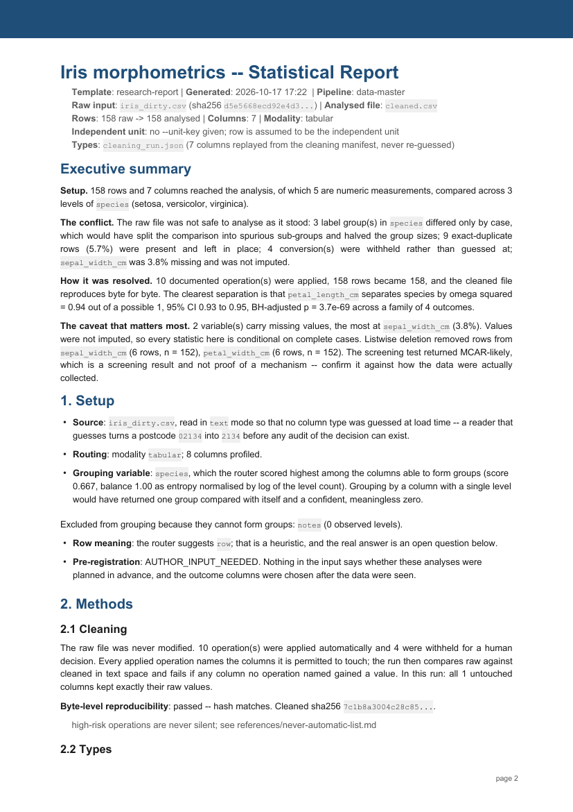

# data-master

**Auditable data analysis from one command.**

[](https://github.com/MAGA2010/data-master/actions/workflows/ci.yml)
[](https://www.python.org/)
[](LICENSE)
[](SKILL.md)

`data-master` is a Codex skill and standalone Python pipeline for turning
raw data into a reproducible report with a complete evidence trail. One
command identifies the input modality, profiles the data without modifying
it, plans and executes safe cleaning, runs statistics where the data supports
them, perturbs them to see if they survive, creates figures, and delivers
Markdown and PDF reports with a machine-checkable audit.

It is built for workflows where an answer must survive inspection: research
analysis, data quality review, exploratory reporting, and AI-assisted work that
still needs transparent decisions.

**Built for:** one-file datasets (tabular gets the full analysis; time-series,
text, image, audio, and geospatial get honestly-labelled profiles), evidence
trails that outlive the run, and readers who will challenge the numbers.

**Not a replacement for:** statistical judgment, peer review, or a BI dashboard.
The audit enforces reporting discipline; it does not validate scientific truth,
and its limitations are printed in every report it produces.



## Contents

- [Why data-master](#why-data-master) · [Installation](#installation) · [Quick start](#quick-start)
- [Execution modes](#execution-modes) · [Command-line reference](#command-line-reference) · [Pipeline architecture](#pipeline-architecture)
- [Supported inputs](#supported-inputs) · [Output contract](#output-contract)
- [Reproducibility and data safety](#reproducibility-and-data-safety) · [Resume and inspection](#resume-and-inspection) · [Answering held decisions](#answering-held-decisions)
- [Report audit](#report-audit) · [Examples](#examples) · [Development](#development)
- [Scope and limitations](#scope-and-limitations) · [中文简介](#中文简介)

## Why data-master

Most automated analysis tools optimize for the shortest path to a polished answer.
`data-master` optimizes for an answer that can be traced, repeated, and challenged.

| Common failure | data-master control |
|---|---|
| A reader silently changes `02134` to `2134` | All text cells are read as text; conversions are explicit plan operations |
| Cleaning changes columns nobody approved | Every changed value must belong to a named operation; untouched columns are audited |
| A statistical test is selected without explanation | Tests, assumptions, alternatives, effect sizes, and confidence intervals are recorded |
| Repeated rows inflate the sample size | The unit structure is classified (clustered / paired / blocks) and the primary analysis runs at the level it supports; row-level results are demoted to a labelled secondary |
| "Sensitivity tested" means one robustness check | Leave-one-group-out, block jackknife, extreme-value fence, and complete-case refits run in `analysis/sensitivity.json`; gate 6 reads that artifact |
| A report overstates the study design | A shared phrase audit blocks unsupported causal upgrades |
| Outputs cannot be reproduced | Cleaning replay is checked byte-for-byte; inputs are fingerprinted; the pipeline commit is recorded and `--export-lockfile` pins exact versions |
| A failed run starts from zero | `state.json` records stage status, commands, duration, and evidence for resume |
| Non-tabular data receives invented inference | Unsupported modalities receive an explicitly labelled profile-only report |

The project does not replace statistical judgment or peer review. It makes the
judgment that was actually applied visible, testable, and easier to correct.

## Installation

### Install with npm from GitHub

Requires Node.js 20+ and Python 3.11+. This package is installed from GitHub;
it is not published to the npm registry.

```bash
npm install -g github:MAGA2010/data-master
data-master setup
data-master doctor
data-master demo --out outputs/first-demo
```

Or use npx without a global npm installation:

```bash
npx --yes --package=github:MAGA2010/data-master data-master setup
npx --yes --package=github:MAGA2010/data-master data-master demo --out outputs/first-demo
```

The npm package has no installation hooks and no JavaScript dependencies.
Only the explicit `setup` command creates a cached Python virtual environment
and downloads the declared Python dependencies. It leaves global Python packages
alone. Ordinary analysis commands do not install anything. Set
`DATA_MASTER_PYTHON` to an existing Python environment's executable to use that
environment directly instead; set `DATA_MASTER_CACHE` to relocate the managed
environment. `--version` and `--help` work even without Python. For reproducible
GitHub installations, append `#<commit>` to the GitHub package specifier.

The npm and Python entry points share the same analysis engine and evidence
contract. Choose either installation route. Installing the npm wrapper does not
automatically register the Codex skill.

### Install the CLI

From a cloned checkout:

```bash
python -m pip install .
data-master doctor
data-master demo --out outputs/first-demo
data-master verify outputs/first-demo --json
```

The demo copies a small synthetic dataset into a new output directory and runs
the full analysis, PDF and audit workflow. It refuses to overwrite an existing
directory. Open `outputs/first-demo/report.pdf` to read the result. If your
Python scripts directory is not on PATH, use `python -m data_master` in place of
`data-master`.

This installs from the checkout; no PyPI publication is assumed. The wheel
includes the runtime scripts, method references and demo input, so the installed
commands also work outside the repository. The Codex skill still needs the
separate skill-folder installation below.

```bash
data-master analyze measurements.csv --out outputs/study --group treatment --unit-key participant_id
data-master resume outputs/study/state.json
```

`analyze` and `resume` forward pipeline options, including `--answers` and
`--covariates`. Use `data-master analyze --help` for the full option list.
`doctor --json` checks bundled resources, dependency versions and actual imports
without installing packages or changing user data. Exit codes: `0` success,
`1` failed analysis/audit or integrity check, `2` usage/environment problem.
Audit verdicts remain separate from process success: a completed report can
still contain unresolved scientific questions.

### Requirements

- Python 3.11, 3.12, or 3.13
- Git
- A platform supported by the Python scientific stack

```bash
git clone https://github.com/MAGA2010/data-master.git
cd data-master
python -m pip install --upgrade pip
python -m pip install -r requirements.txt
```

The pipeline never installs packages silently. It records a dependency preflight
and stops with the missing requirements when a selected stage cannot run.

### Use as a Codex skill

Clone the repository:

```bash
git clone https://github.com/MAGA2010/data-master.git
```

Then copy or link it into your Codex skills directory. On PowerShell:

```powershell
Copy-Item -Recurse data-master "$env:USERPROFILE\.codex\skills\data-master"
```

On macOS or Linux:

```bash
cp -R data-master ~/.codex/skills/data-master
```

The root [SKILL.md](SKILL.md) is the Codex routing entry point. It coordinates
the ten stage-specific skills under [`skills/`](skills/).

## Quick start

Run the included Iris example into a fresh output directory (takes a minute or
two; write your own outputs anywhere you like, the examples' committed
artifacts stay untouched):

```bash
python scripts/run_pipeline.py \
  --in examples/iris/iris_dirty.csv \
  --out outputs/iris-demo \
  --title "Iris morphometrics" \
  --journal nature
```

This is what the run actually prints (abridged; every line here is a real
stage artifact you can open):

```text
route_input: 1 file(s) -> tabular=1
cleaned : 158 -> 158 rows, 8 -> 7 cols
verify  : PASS byte-for-byte reproducible (7c1b8a3004c28c85...)
audit   : PASS 1 untouched columns kept their raw values exactly

stats_inferential written: .../analysis/inferential.json
  unit structure : undeclared  primary level: row
  tests: 4/5 estimable  family_size=4  correction=BH

sensitivity written: .../analysis/sensitivity.json
  outcomes: 4  perturbations: 64  agreeing: 64  conflicting: 0

final_audit: NOT SUBMISSION-READY
  Gate 1 n explicit and unit-defined            FAIL
  Gate 6 sensitivity tested                     PASS
  ... (gate 2 warns: missingness mechanism undetermined; other gates pass; structural 6/6)

complete: outputs/iris-demo
  report:  outputs/iris-demo/report.pdf     <- start here
  audit:   NOT SUBMISSION-READY             <- and here, to see why
  answers: outputs/iris-demo/answers.template.json
```

Two things to notice in that output. The report **exists** while the audit
says **NOT SUBMISSION-READY** — gate 1 fails because this demo never declared
what one independent unit is (`--unit-key`). That is the designed outcome, not
an error: the audit names exactly what a human must decide. And the
`answers.template.json` line points at the decisions the pipeline refuses to
make on your behalf — fill it in and re-run with `--answers` ([see below](#answering-held-decisions)).

For a smaller and more explicit analysis:

```bash
python scripts/run_pipeline.py \
  --in data/measurements.csv \
  --out outputs \
  --title "Treatment response" \
  --group treatment \
  --unit-key participant_id \
  --outcomes response_time,accuracy \
  --journal nature
```

`--unit-key` is not decorative. Without a valid declaration of what one
independent unit represents, the report is deliberately marked
`NOT SUBMISSION-READY` — and when rows repeat within a unit, the primary
analysis automatically moves to the level the structure supports (per-unit
means, paired tests, or Friedman blocks), with the row-level results kept as
a labelled secondary.

## Execution modes

The runner selects a mode from the route result and records that decision.

| Input shape | What runs |
|---|---|
| One tabular file | Route, profile, clean, validate, describe, infer (unit-aware, optional ANCOVA), sensitivity suite, charts, report, audit |
| One time-series file | Route, profile, audited descriptive statistics (Mann-Kendall + Sen slope with CI, ACF/PACF with white-noise bounds, STL strengths, seeded changepoint screen), report with overview figure, phrase-scanned audit |
| One text, image, audio, or geospatial input | Route, profile, profile-only PDF, integrity audit |
| Mixed folder or multiple files | One profile branch per modality or file, followed by a merged profile-only report |
| Input above 300 MB | Blocked with the options spelled out, unless `--max-input-mb` overrides |
| Unknown format | Stops with a route record and points to the research protocol |

Profile-only is an explicit scope boundary. It reports structure, integrity
issues, missingness, duplicates, and modality-specific findings without claiming
that a statistical model or causal analysis was performed. The time-series mode
is the one non-tabular exception: it carries real descriptive statistics, each
with its test name, n, and interval — and still no forecast and no causal claim.

## Command-line reference

| Option | Purpose |
|---|---|
| `--in PATH` | File, directory, or glob input |
| `--out DIR` | Output directory |
| `--title TEXT` | Report title |
| `--group COLUMN` | Override automatic grouping selection |
| `--outcomes A,B` | Restrict inferential outcomes |
| `--unit TEXT` | Describe what one row represents |
| `--unit-key COLUMN` | Declare the independent-unit identifier; repeated rows trigger unit-level, paired, or repeated-measures analysis automatically |
| `--journal auto\|nature\|nejm\|science\|lancet` | Journal checklist family |
| `--design ID` | EQUATOR study-design identifier |
| `--modality NAME` | Force a routing modality |
| `--answers FILE` | Answer the plan's never-automatic decisions by id (`answers.template.json` is written for you); a `run` block may also declare `unit_key` / `group` / `outcomes` / `design` / `journal` / `covariates` |
| `--covariates A,B` | Declare numeric covariates; the ANCOVA comparison becomes primary and the slopes assumption is tested |
| `--max-input-mb N` | Override the 300 MB in-memory input gate |
| `--export-lockfile` | Write `lockfile.txt` with the exact dependency versions that ran |
| `--profile-only` | Stop after profiling and report generation |
| `--pdf-backend auto\|reportlab\|fpdf2\|headless-browser` | Select the PDF backend |
| `--resume STATE` | Resume an existing `state.json` |
| `--force` | Re-run stages instead of reusing completed evidence |

View the built-in help:

```bash
python scripts/run_pipeline.py --help
```

## Pipeline architecture

```text
input file / folder / glob
        |
        v
  route -> preflight -> profile
        |                  |
        |                  +---- non-tabular / mixed ----> profile report -> audit
        |
        +---- one tabular file
                 |
                 v
             cleaning plan  (never-automatic holds -> answers.template.json)
                 |
                 v
      execute -> validate -> describe
                 |
                 v
           inferential analysis  (unit-aware: clustered / paired / blocks)
                 |
                 v
           sensitivity suite  (leave-one-group-out, jackknife, fence, complete case)
                 |
                 v
        chart decisions -> charts
                 |
                 v
          report.md / report.pdf
                 |
                 v
           structural + 8-gate audit
```

Every stage writes evidence to disk before it is considered complete. The runner
uses that evidence, rather than console output or an in-memory flag, to decide
whether a stage can be reused.

### Core components

| Component | Responsibility |
|---|---|
| [`scripts/run_pipeline.py`](scripts/run_pipeline.py) | One-command orchestration and execution mode selection |
| [`scripts/route_input.py`](scripts/route_input.py) | File inspection and modality routing |
| [`scripts/profile_*.py`](scripts/) | Modality-specific structural profiling |
| [`scripts/cleaning_plan.py`](scripts/cleaning_plan.py) | Explicit, reviewable cleaning plan plus the answers-file loop |
| [`scripts/execute_cleaning.py`](scripts/execute_cleaning.py) | Additive cleaning with a replayable script |
| [`scripts/stats_*.py`](scripts/) | Descriptive and unit-aware inferential statistics (mixed models, ANCOVA) |
| [`scripts/sensitivity_analysis.py`](scripts/sensitivity_analysis.py) | Leave-one-group-out, block jackknife, extreme-value fence, complete-case refits |
| [`scripts/timeseries_analysis.py`](scripts/timeseries_analysis.py) | Audited descriptive time-series statistics: Mann-Kendall, Theil-Sen, ACF/PACF, STL, changepoint screen |
| [`scripts/final_audit.py`](scripts/final_audit.py) | Machine-derived report and journal audit |
| [`scripts/pipeline_state.py`](scripts/pipeline_state.py) | Input fingerprints, stage ledger, and pipeline provenance |
| [`scripts/state_keeper.py`](scripts/state_keeper.py) | State inspection, evidence validation, and resume entry point |

## Supported inputs

| Modality | Formats and examples | Current depth |
|---|---|---|
| Tabular | CSV, TSV, Excel, JSON, JSONL, Parquet | Full analysis pipeline |
| Time series | Timestamped tabular data | Profiling plus audited descriptive statistics |
| Text corpus | TXT and mixed-encoding document sets | Corpus profiling |
| Image set | PNG, JPEG, WebP, TIFF | Decode, metadata, brightness, near-duplicate profiling |
| Audio set | WAV, MP3, FLAC and related formats | Duration, rate, channel, clipping, and silence profiling |
| Geospatial | GeoJSON, shapefiles, coordinate tables | CRS, bounds, coordinate validity, coincidence profiling |
| Mixed input | Folders containing several supported modalities | Branch profiling and combined profile-only report |

Unknown and unsupported formats are routed to
[`references/research-protocol.md`](references/research-protocol.md) rather than
being treated as tabular data by default.

## Output contract

```text
outputs/
|-- report.pdf
|-- report.md
|-- executive_summary.md
|-- report_build.json
|-- state.json
|-- route.json
|-- preflight.json
|-- cleaning_plan.json
|-- charts_rendered.json
|-- answers.template.json
|-- audit/
|   |-- final_audit.json
|   `-- final_audit.md
|-- analysis/
|   |-- profile.json
|   |-- descriptive.json
|   |-- inferential.json
|   |-- sensitivity.json
|   `-- chart_decisions.json
|-- cleaned/
|   |-- cleaned.csv
|   |-- clean_<dataset>.py
|   |-- cleaning_run.json
|   `-- validation.json
`-- charts/
    `-- *.png
```

The important files are:

- `report.pdf`: the primary human-readable deliverable.
- `report.md`: the citable report source.
- `report_build.json`: hashes, provenance, PDF backend, pipeline commit, and registered report values.
- `analysis/*.json`: machine-readable statistical, sensitivity, and chart decisions.
- `audit/final_audit.*`: the final audit verdict and actionable failures.
- `state.json`: completed stages, commands, durations, and evidence paths.
- `answers.template.json`: every never-automatic decision this dataset raised,
  fillable and fed back with `--answers` (with `--export-lockfile`,
  `lockfile.txt` pins the exact dependency versions that ran).

## Reproducibility and data safety

The pipeline applies four non-negotiable data-integrity rules.

1. **Raw input is never modified.** Outputs are additive and generated under the
   selected output directory.
2. **Types are explicit.** Text cells remain text until a recorded operation
   proves that every value can be converted. Conversions are all-or-nothing.
3. **Only approved columns may change.** The cleaned output is compared against
   the raw input in text space, and an unexpected value change fails validation.
4. **Types are decided once.** A dtype manifest is saved and replayed by every
   downstream stage instead of being guessed again.

Cleaning also produces a standalone replay script. Re-running that script on the
raw input must reproduce the cleaned output hash exactly.

## Resume and inspection

Inspect a run:

```bash
python scripts/state_keeper.py --state outputs/state.json --show
```

Validate every recorded evidence path:

```bash
python scripts/state_keeper.py --state outputs/state.json --validate
```

Resume an interrupted run:

```bash
python scripts/run_pipeline.py --resume outputs/state.json
```

Completed stages are reused only when their saved SHA-256 hashes match and the
execution context (source files, method references, dependency versions and run
options) is unchanged. Changed evidence invalidates its producing stage and all
downstream stages, including for already completed runs. Raw input changes still
require a fresh run. Legacy states without hashes are rebuilt conservatively.
Use `--force` when the intent is to rebuild all artifacts.

Verify a delivered run without changing it:

```bash
python scripts/verify_artifacts.py --outdir outputs --json
```

Verification checks content integrity against `state.json`, including PDFs,
figures and cleaning replay scripts. It does not establish scientific validity
or authenticity if both the artifacts and ledger have been rewritten.

## Answering held decisions

Whenever the cleaning plan holds a conversion or flags a destructive operation,
it writes `outputs/answers.template.json` listing every open decision with its
stable id, the actions the pipeline can actually execute, and the question it
needs answered. Fill in the `action` and `rationale` fields and re-run:

```bash
python scripts/run_pipeline.py --resume outputs/state.json --answers outputs/answers.template.json
```

Every id and action is validated against the plan before anything applies, the
decision is recorded with who decided, when, and why, and a changed answers
file invalidates the cleaning and downstream stages rather than silently
reusing their old evidence. Actions with no automatic implementation
(`drop_rows`, `listwise_delete`) are rejected instead of skipped.

The same file can settle the run-level questions the audit would otherwise
flag: a `run` block may declare `unit_key`, `group`, `outcomes`, `design`,
`journal`, or `covariates` (validated against the profile; explicit CLI values
always win). And a decision may name a single `column` of a multi-column flag —
impute `age` with the median and leave `bmi` alone, answering each column at
a time, with the flag staying open until every column has an answer.

## Report audit

The default audit is journal-oriented and derives results from saved artifacts,
not from the report's own claims.

| Gate | Requirement |
|---|---|
| 1 | Sample size and independent unit are explicit, and the primary analysis lives at the level the unit structure supports |
| 2 | Missingness assumptions are explicit; an undetermined mechanism produces a warning |
| 3 | Effect size accompanies p-values |
| 4 | Uncertainty is visible |
| 5 | Multiple comparisons are corrected |
| 6 | The sensitivity suite (`analysis/sensitivity.json`) perturbed the primary analysis and every conflict is reported |
| 7 | Association is not upgraded to mechanism |
| 8 | Unknowns are marked `AUTHOR_INPUT_NEEDED` |

Journal profiles include Nature, NEJM, Science, and Lancet. Design routing covers
common EQUATOR checklists such as CONSORT, STROBE, PRISMA, MOOSE, STARD, ARRIVE,
SQUIRE, and CARE.

Run the audit independently:

```bash
python scripts/final_audit.py --outdir outputs --journal nature
python scripts/final_audit.py --outdir outputs --journal nejm --design randomized_trial
python scripts/final_audit.py --outdir outputs --journal lancet --template standard
```

A report can exist while the audit says `NOT SUBMISSION-READY`. This is an
intentional outcome, not a missing output. The audit identifies what still needs
to be resolved.

## Examples

| Example | Demonstrates |
|---|---|
| [`examples/independent_groups`](examples/independent_groups/) | Synthetic two-group comparison with declared units, effect intervals and read-only verification |
| [`examples/iris`](examples/iris/) | Full tabular analysis, automatic grouping, effect sizes, figures, and PDF |
| [`examples/column_traps`](examples/column_traps/) | Leading zeros, currency, percentages, mixed values, and date ambiguity |
| [`examples/timeseries`](examples/timeseries/) | Time-series mode: gaps, duplicate stamps, regime change, plus the descriptive statistics stage |
| [`examples/text`](examples/text/) | Duplicate and empty documents, plus legacy encoding fallback |
| [`examples/media`](examples/media/) | Corrupt images, re-encoded near-duplicates, and blank frames |
| [`examples/geo`](examples/geo/) | Invalid coordinates, null island, and missing geometry |

Run any supported example through the one-command interface:

```bash
python scripts/run_pipeline.py \
  --in examples/timeseries/sensor_log.csv \
  --out outputs/timeseries \
  --title "Sensor stability review"
```

## Development

Run the invariant and regression suite:

```bash
python tests/test_pipeline_invariants.py
python tests/test_reliability.py
python tests/test_pipeline_integrity.py
python tests/test_distribution.py
```

Check syntax:

```bash
python -m compileall scripts tests
```

The suite covers type preservation, all-or-nothing conversions, untouched-column
auditing, dtype replay, byte-reproducible cleaning, multiplicity safeguards,
Welch denominator degrees of freedom, causal-language consistency, routing,
profile-only scope, state transitions, unit-structure classification
(clustered / paired / incomplete repeated), the gate-1 clustering block, the
random-intercept mixed model and its fallback, the group-equals-unit refusal,
ANCOVA with the slopes assumption, gate-3 recognition of the new effect sizes,
the answers-file round trip (per-column and run block) and resume invalidation,
the time-series statistics and their intervals, the input-size gate, pipeline
commit provenance, lockfile export, and end-to-end report generation.

GitHub Actions runs the project on Windows and Linux with Python 3.11, 3.12, and
3.13, including the one-command tabular and profile-only paths.

## Project structure

```text
.
|-- SKILL.md                  Codex entry point and routing contract
|-- scripts/                  Deterministic pipeline implementation
|-- skills/                   Ten stage-specific Codex skills
|-- references/               Methodological and reporting references
|-- examples/                 Reproducible demonstration datasets
|-- tests/                    Invariant and end-to-end tests
|-- docs/                     Architecture notes and README assets
|-- requirements.txt          Runtime dependencies
|-- CONTRIBUTING.md           Contribution workflow
|-- SECURITY.md               Security and disclosure policy
`-- LICENSE                   MIT
```

The numerical-reference suite independently calculates the mixed-model profile
likelihood using block GLS, paired-test statistics from differences, and ANCOVA
partial F statistics and coefficient intervals using matrix least squares. It
also exercises nonconvergence, invalid intervals, low missingness, changed
artifacts, changed options, legacy state, and read-only verification. The separate
integration test corrupts saved inference and removes the PDF, then checks that
resume rebuilds the affected stages while reusing valid upstream evidence. See
[`tests/test_reliability.py`](tests/test_reliability.py).

## Scope and limitations

Current limitations are explicit:

- Full inferential analysis currently applies to a single tabular file.
- Incomplete repeated measures require a converged ML random-intercept model;
  failed fits remain unresolved. Repeated cell means are not an independent-
  samples fallback.
- Missingness mechanisms cannot be established from a missing fraction or the
  exploratory association screen. They remain author questions.
- Coefficient intervals do not certify uncertainty in model R² or omega-squared;
  the audit warns where those effect-size intervals are unavailable.
- Time-series inputs receive audited **descriptive** statistics (trend, slope
  with CI, autocorrelation, decomposition strengths, changepoint screen);
  forecasting and ARIMA-style model fitting are not implemented.
- Text, image, audio, geospatial, and mixed inputs produce profile-only reports.
- Covariate adjustment requires user-declared `--covariates`; the pipeline
  never selects covariates itself, because adjusting for a data-chosen
  variable is a researcher-degrees-of-freedom problem.
- Answers-file actions cover the operations the executor implements; row
  deletion choices beyond exact deduplication still require editing the plan.
- PDF, DOCX, HTML, and video conversion are outside the v1 scope.
- The audit supports reporting discipline; it does not validate scientific truth.

These boundaries are part of the output contract. Unsupported analysis is marked
as unsupported instead of being silently replaced with a weaker claim.

## Contributing

Contributions are welcome when they preserve the evidence contract. Start with
[`CONTRIBUTING.md`](CONTRIBUTING.md), add regression coverage for behavior
changes, and keep generated user data out of commits.

For security and data-disclosure concerns, follow [`SECURITY.md`](SECURITY.md).

## Citation

If you use `data-master` in research or technical work, cite the repository and
the exact commit used for the analysis — the commit is recorded in every run's
`state.json` and `report_build.json`, so it can be copied from the evidence
rather than remembered:

```text
Wang, S. data-master: Auditable data analysis from one command.
https://github.com/MAGA2010/data-master
```

```bibtex
@software{wang_data_master,
  author = {Wang, S.},
  title  = {data-master: Auditable data analysis from one command},
  url    = {https://github.com/MAGA2010/data-master}
}
```

## License

Released under the [MIT License](LICENSE).

## 中文简介

`data-master` 是一个可审计的数据分析 Skill 与 Python 流水线。输入文件、目录或
glob 后，它会自动判断数据模态、完成画像与安全清理、运行适用的统计分析、生成图表，
并输出 Markdown、PDF、审计结果和完整证据链。

```bash
python scripts/run_pipeline.py \
  --in data.csv \
  --out outputs \
  --title "数据分析报告"
```

核心原则：

- 永不修改原始文件；
- 类型转换显式、可逆、全量可解析才执行；
- 重复行不会虚增样本量：声明 `--unit-key` 后，主分析自动移到结构支持的层级（单位均值 / 配对 / 区组 / 单位随机截距混合模型）；
- 协变量由用户用 `--covariates` 显式声明后才做 ANCOVA 调整，斜率同质性假设随结果一并报告；
- 统计方法和清理操作均记录证据；敏感性扰动（留一组、分块 jackknife、极端值围栏、完整个例）写入 `analysis/sensitivity.json`；
- 时间序列输入交付可审计的描述统计（Mann-Kendall 趋势、Sen 斜率+CI、ACF/PACF、STL 强度、变点筛查），不做预测与因果声明；
- 无法确定的单位或设计问题标记为 `AUTHOR_INPUT_NEEDED`，并生成 `answers.template.json` 供用户按 id（或按列）作答、用 `run` 块声明单位/分组/设计/期刊后，用 `--answers` 重跑；
- 非表格与混合输入只交付明确标注的 profile-only 报告；超过 300 MB 的输入会被显式拦下而不是崩溃；
- 报告存在不等于可提交，必须通过机器可核验的审计门禁；
- 每次运行记录生成报告的代码 commit，`--export-lockfile` 固化精确依赖版本。
