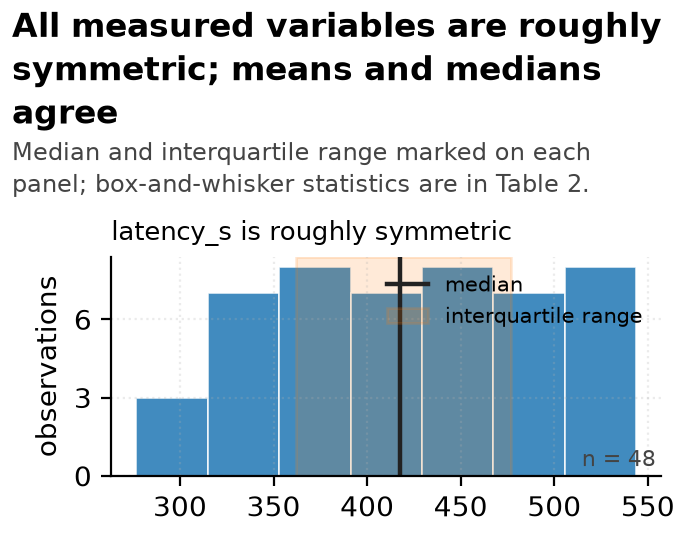
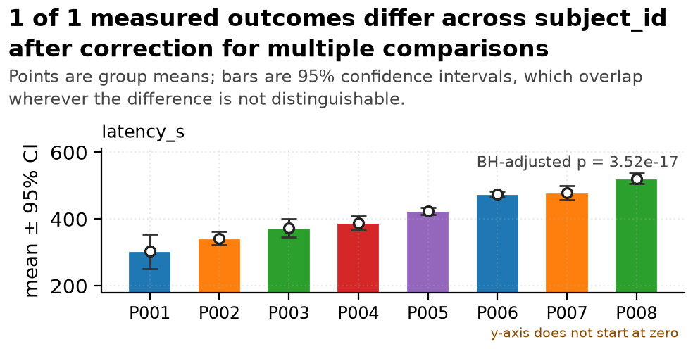

# Date-versus-number ambiguity -- Statistical Report

> **Template**: nature | **Generated**: 2026-10-19 20:07 中国标准时间 | **Pipeline**: data-master
> **Raw input**: `session_export.csv` (sha256 `62619a7e5b45c756...`) | **Analysed file**: `cleaned.csv`
> **Rows**: 48 raw -> 48 analysed | **Columns**: 3 | **Modality**: tabular
> **Independent unit**: no --unit-key given; the row is assumed to be the independent unit, and every test below inherits that assumption
> **Types**: `cleaning_run.json` (3 columns replayed from the cleaning manifest, never re-guessed)

## Executive summary

**Setup.** 48 rows and 3 columns reached the analysis, of which 1 are numeric measurements, compared across 8 levels of `subject_id` (P001, P002, P003, P004, P005, P006, P007, P008).

**The conflict.** The raw file was not safe to analyse as it stood: 1 conversion(s) were withheld rather than guessed at.

**How it was resolved.** 9 documented operation(s) were applied, 48 rows became 48, and the cleaned file reproduces byte for byte. The clearest separation is that `latency_s` is compared across subject_id: omega squared = 0.87, 95% CI 0.84 to 0.93, BH-adjusted p = 3.5e-17 across a family of 1 outcomes.

**The caveat that matters most.** The independent unit was never declared, so each row was treated as one observation. If a row pools several plants, fields, patients or technical replicates, the effective n is smaller than the row count and every interval below is too narrow -- usually by more than the replication factor. The groups were also not assigned, so differences between them are associations and this data cannot support a reading in which the group label produced the measurement.

## 1. Setup

- **Source**: `session_export.csv`, read in `text` mode so that no column type was guessed at load time -- a reader that guesses turns a postcode `02134` into `2134` before any audit of the decision can exist.
- **Routing**: modality `tabular`; 3 columns profiled.
- **Grouping variable**: `subject_id`, which the router scored highest among the columns able to form groups (score 0.244, balance 0.95 as entropy normalised by log of the level count). Grouping by a column with a single level would have returned one group compared with itself and a confident, meaningless zero.
- **Row meaning**: the router suggests `row`; that is a heuristic, and the real answer is an open question below.
- **Pre-registration**: AUTHOR_INPUT_NEEDED. Nothing in the input says whether these analyses were planned in advance, and the outcome columns were chosen after the data were seen.

## 2. Methods

### 2.1 Cleaning

The raw file was never modified. 9 operation(s) were applied automatically and 1 were withheld for a human decision. Every applied operation names the columns it is permitted to touch; the run then compares raw against cleaned in text space and fails if any column no operation named gained a value. In this run: all 2 untouched columns kept exactly their raw values.

**Byte-level reproducibility**: passed -- hash matches. Cleaned sha256 `45480b1e8fbbdd69...`.

> high-risk operations are never silent; see references/never-automatic-list.md

### 2.2 Types

Types were decided once and replayed, never re-guessed: 3 columns were typed from the manifest in `cleaning_run.json`. A column that the cleaning stage declared textual cannot quietly become numeric in the analysis stage while the report still describes it as an identifier. Dtype source for the analysis stage: `cleaning_run.json`.

### 2.3 Missing data

No variable carries missing values.

### 2.4 Test selection

| Outcome | Design | Method | Statistic | df | p (raw) | p (corrected) | Alternatives rejected |
|---|---|---|---|---|---|---|---|
| `latency_s` | 8-group numeric | one-way ANOVA | F = 46.133 | 7 | = 3.5e-17 | = 3.5e-17 | Welch ANOVA: equal variance holds (Levene p > alpha); the pooled test is more powerful; Kruskal-Wallis H: min n=2 >= 30; the mean statistic is robust by CLT |

### 2.5 Multiple comparisons

The primary family holds **1 outcomes**, one per measured variable, corrected by **BH** at alpha = 0.050. 1 of 1 survive the correction. one outcome = one member of the family; correction applies across outcomes, and separately within each post-hoc pairwise family

## 3. Results

### 3.1 What is in the table

| Column | Role after cleaning | n | % missing | Distinct values | Status |
|---|---|---|---|---|---|
| `subject_id` | categorical | 48 | 0.0 | 8 | kept |
| `session_stamp` | categorical | 48 | 0.0 | 38 | kept |
| `latency_s` | numeric | 48 | 0.0 | continuous | kept |

### 3.2 Descriptive statistics

| Variable | n | % miss | Mean (95% CI) | SD | Median (IQR) | Range | Skew |
|---|---|---|---|---|---|---|---|
| `latency_s` | 48 | 0.0 | 421.49 (401.69 to 441.30) | 70.00 | 417.56 (361.87-477.10) | [276.70, 543.86] | -0.04 |

Mean and median are both given because they disagree wherever the distribution is skewed. The mean column carries a normal-approximation interval, which for a skewed variable is the least trustworthy number on this table; the median and IQR beside it are not.

### 3.3 Categorical variables

| Variable | n | Distinct | Mode | Distribution |
|---|---|---|---|---|
| `subject_id` | 48 | 8 | `P002` | P002 (9), P005 (9), P007 (8), P008 (7), P004 (6), P003 (4) |
| `session_stamp` | 48 | 38 | `20240129` | 20240129 (2), 20240118 (2), 20240126 (2), 20240226 (2), 20240224 (2), 20240205 (2) |

### 3.4 Group comparison

| Outcome | Method | Statistic | n | Effect size (95% CI) | p (raw) | p (BH-adjusted) |
|---|---|---|---|---|---|---|
| `latency_s` | one-way ANOVA | F = 46.13 | 48 | omega squared = 0.868 (95% CI 0.84 to 0.93) | = 3.5e-17 | = 3.5e-17 |

Read the effect-size column before the p column. `latency_s` is compared across subject_id: omega squared = 0.87, 95% CI 0.84 to 0.93, BH-adjusted p = 3.5e-17 across a family of 1 outcomes. The ordering by effect size and the ordering by p value are not the same statement, and at this sample size the p values are small enough that their exact magnitude carries no information beyond "smaller than this table can resolve".

### 3.5 Pairwise comparisons

| Outcome | Pair | n (a / b) | Mean difference (95% CI) | Cliff's delta | p (BH-adjusted) |
|---|---|---|---|---|---|
| `latency_s` | P001 vs P002 | 2 / 9 | -39.27 (95% CI -252.61 to 174.07) | -0.667 | = 0.383 |
| `latency_s` | P001 vs P003 | 2 / 4 | -70.13 (95% CI -236.54 to 96.29) | -1.000 | = 0.196 |
| `latency_s` | P001 vs P004 | 2 / 6 | -85.25 (95% CI -284.35 to 113.84) | -1.000 | = 0.175 |
| `latency_s` | P001 vs P005 | 2 / 9 | -121.10 (95% CI -402.74 to 160.54) | -1.000 | = 0.151 |
| `latency_s` | P001 vs P006 | 2 / 3 | -170.59 (95% CI -469.58 to 128.40) | -1.000 | = 0.120 |
| `latency_s` | P001 vs P007 | 2 / 8 | -175.60 (95% CI -379.19 to 27.99) | -1.000 | = 0.085 |
| `latency_s` | P001 vs P008 | 2 / 7 | -218.56 (95% CI -463.70 to 26.59) | -1.000 | = 0.084 |
| `latency_s` | P002 vs P003 | 9 / 4 | -30.85 (95% CI -72.14 to 10.44) | -0.500 | = 0.150 |
| `latency_s` | P002 vs P004 | 9 / 6 | -45.98 (95% CI -78.03 to -13.93) | -0.741 | = 0.016 |
| `latency_s` | P002 vs P005 | 9 / 9 | -81.83 (95% CI -106.36 to -57.30) | -1.000 | = 3.5e-05 |
| `latency_s` | P002 vs P006 | 9 / 3 | -131.31 (95% CI -155.43 to -107.19) | -1.000 | = 2.6e-06 |
| `latency_s` | P002 vs P007 | 9 / 8 | -136.33 (95% CI -167.06 to -105.60) | -1.000 | = 1.7e-06 |
| `latency_s` | P002 vs P008 | 9 / 7 | -179.28 (95% CI -206.27 to -152.29) | -1.000 | = 3.0e-08 |
| `latency_s` | P003 vs P004 | 4 / 6 | -15.13 (95% CI -57.63 to 27.38) | -0.250 | = 0.437 |
| `latency_s` | P003 vs P005 | 4 / 9 | -50.98 (95% CI -92.41 to -9.54) | -0.944 | = 0.042 |
| `latency_s` | P003 vs P006 | 4 / 3 | -100.46 (95% CI -142.74 to -58.18) | -1.000 | = 0.007 |
| `latency_s` | P003 vs P007 | 4 / 8 | -105.47 (95% CI -147.24 to -63.70) | -1.000 | = 0.002 |
| `latency_s` | P003 vs P008 | 4 / 7 | -148.43 (95% CI -189.45 to -107.41) | -1.000 | = 7.3e-04 |
| `latency_s` | P004 vs P005 | 6 / 9 | -35.85 (95% CI -64.28 to -7.42) | -0.815 | = 0.033 |
| `latency_s` | P004 vs P006 | 6 / 3 | -85.33 (95% CI -113.71 to -56.95) | -1.000 | = 7.3e-04 |
| `latency_s` | P004 vs P007 | 6 / 8 | -90.34 (95% CI -123.45 to -57.24) | -1.000 | = 3.1e-04 |
| `latency_s` | P004 vs P008 | 6 / 7 | -133.30 (95% CI -163.41 to -103.19) | -1.000 | = 1.5e-05 |
| `latency_s` | P005 vs P006 | 9 / 3 | -49.48 (95% CI -66.07 to -32.90) | -1.000 | = 4.2e-04 |
| `latency_s` | P005 vs P007 | 9 / 8 | -54.50 (95% CI -80.80 to -28.20) | -0.944 | = 0.002 |
| `latency_s` | P005 vs P008 | 9 / 7 | -97.45 (95% CI -118.58 to -76.32) | -1.000 | = 3.3e-06 |
| `latency_s` | P006 vs P007 | 3 / 8 | -5.01 (95% CI -31.00 to 20.97) | -0.250 | = 0.672 |
| `latency_s` | P006 vs P008 | 3 / 7 | -47.97 (95% CI -68.83 to -27.11) | -1.000 | = 0.002 |
| `latency_s` | P007 vs P008 | 8 / 7 | -42.96 (95% CI -71.41 to -14.50) | -0.750 | = 0.012 |

Each pairwise family is corrected separately, so these p values answer a narrower question than the omnibus values in 3.4 and should not be compared with them.

## 4. Discussion

**What the data supports.** The measurements differ across levels of `subject_id` by margins larger than the sampling noise at this size: `latency_s` is compared across subject_id: omega squared = 0.87, 95% CI 0.84 to 0.93, BH-adjusted p = 3.5e-17 across a family of 1 outcomes.

**What the data does not support.** Nothing here establishes that the group label produced the measurement. The design compares existing groups rather than assigning them, and species, batch, site, instrument and operator all travel together with the group label -- this table cannot separate them. A claim of the form "X caused Y" is therefore not available from these data, and none is made in this report.

**Boundary conditions.** These results describe the rows in this file, at these measurement conditions, with this instrument. The intervals quantify sampling variation inside that set; they say nothing about another lot, another season or another population. The corrected family covers the outcomes tested here, so an outcome that was not tested is not thereby null.

## 5. Caveats and limitations

**C1. design.** The independent unit was never declared, so each row was treated as one observation. If a row pools several plants, fields, patients or technical replicates, the effective n is smaller than the row count and every interval below is too narrow -- usually by more than the replication factor. The groups were also not assigned, so differences between them are associations and this data cannot support a reading in which the group label produced the measurement.
- *Limits*: the causal reading of every group difference, and the width of every interval
- *Status*: AUTHOR_INPUT_NEEDED: what one row represents

## 6. Reproducibility

Every number above is traceable to a script. Nothing in this report was typed by hand.

| Stage | Script | Artifact | sha256 (first 16) |
|---|---|---|---|
| Profile | scripts/profile_tabular.py | analysis/profile.json | 8a3321cf3aa5f099 |
| Plan | scripts/cleaning_plan.py | cleaning_plan.json | 42e5605ed9090f9b |
| Clean | scripts/execute_cleaning.py | cleaned/cleaned.csv | 45480b1e8fbbdd69 |
| Validate | scripts/validate_clean.py | cleaned/validation.json | dab8826b466b2eb9 |
| Describe | scripts/stats_descriptive.py | analysis/descriptive.json | 3f5ae5fd2893a30b |
| Infer | scripts/stats_inferential.py | analysis/inferential.json | e9374b5c9e391622 |
| Decide figures | scripts/chart_decision.py | analysis/chart_decisions.json | cf7926c752cfd697 |
| Render figures | scripts/render_chart.py | charts/*.png | 55cc00232d60ba09 |
| Assemble | scripts/assemble_report.py | report.md / report.pdf | self-referential -- see report_build.json |

A document cannot contain its own hash, so the hash of `report.md` and `report.pdf` is recorded in `report_build.json` rather than on this page. Every other hash above was computed from the artifact as it exists now.

- **Interpreter**: Python 3.13.15 on Windows-11-10.0.26200-SP0
- **Libraries**: numpy 2.4.6, pandas 3.0.3, scipy 1.18.1
- **Pipeline code**: data-master commit `8749c5ea1ff4` (working tree was dirty; the commit alone does not reproduce it) -- this report names the exact code that produced every number in it.
- **Random seeds**: 42 -- every resampling interval is seeded, so it reproduces exactly.
- **Columns any operation was permitted to touch**: `latency_s`

- **PDF backend**: `reportlab`. The page count, byte count and sha256 of the delivered PDF are recorded in `report_build.json` under `pdf`; the probe that established this backend is under `pdf_probe`. They are not printed here because a document cannot contain its own hash, and a page count measured before the last line changed is not the page count of the file you are reading.
  The data contains non-Latin characters, so the renderer was asked for a CJK-capable font; one was embedded.
## 7. Figures

Each figure carries one argument and its title states that argument as a finding computed from the data rather than as a topic label. The chart types considered and rejected are listed under each one, because choosing a chart is itself a claim about what matters.

### Figure 1 -- All measured variables are roughly symmetric; means and medians agree

*Distribution of each numeric variable, with the median and interquartile range marked. Panel order follows absolute skewness. Full box-and-whisker statistics are in Table 2.*

- **What it shows**: latency_s is roughly symmetric (median 417.56, IQR 361.87 to 477.10, n = 48).
- **How to read it**: Mean and median agree closely for every variable.
- **What follows**: Standard parametric summaries are adequate here.
- **Uncertainty shown**: median and interquartile range marked on every panel
- **Chart alternatives rejected**: one histogram per variable as separate figures -- same argument repeated; the reader has to re-read the framing each time; box plot only -- understates the tail, which is precisely what decides the test choice
- **Source**: `scripts/chart_decision.py` -> `charts/fig01_distribution_panel.png` rendered by `scripts/render_chart.py`, 58,844 bytes, ink ratio 0.3496

### Figure 2 -- 1 of 1 measured outcomes differ across subject_id after correction for multiple comparisons

*Mean of each outcome by subject_id with 95% confidence intervals, P001, P002, P003, P004, P005, P006, P007, P008. one-way ANOVA. Raw p values are BH-corrected across a family of 1 outcomes.*

- **What it shows**: latency_s differs across subject_id by omega squared = 0.868 (95% CI 0.843 to 0.930), BH-adjusted p = 3.515e-17.
- **How to read it**: Every tested outcome separates the groups.
- **What follows**: Carry the effect sizes forward, not the p values: a difference that is real can still be too small to matter.
- **Uncertainty shown**: 95% confidence intervals on every group mean
- **Chart alternatives rejected**: pie chart -- group means are not parts of a whole; 3D bar chart -- the third dimension encodes nothing; radar chart -- angle and area are hard to compare and imply the axes are commensurate
- **Source**: `scripts/chart_decision.py` -> `charts/fig02_small_multiples_ci.png` rendered by `scripts/render_chart.py`, 69,190 bytes, ink ratio 0.2037

## 8. Figure specifications

| # | ID | Chart type | Specification |
|---|---|---|---|
| 1 | `fig01_distribution_panel` | distribution_panel | 1 panels; bins = auto; show_median_iqr = True |
| 2 | `fig02_small_multiples_ci` | small_multiples_ci | group = subject_id; 1 panels; n_panels = 1 |

## Appendix A1. Sensitivity and stability

The primary analysis was re-run under perturbation by `scripts/sensitivity_analysis.py` (seed 42, 10 blocks for the jackknife). Agreement means the significance verdict did not flip at alpha=0.05.

| Outcome | Perturbation | Statistic | p | Verdict |
|---|---|---|---|---|
| `latency_s` | leave_one_group_out (P001) | one-way ANOVA = 47.61 | = 2.0e-16 | agrees |
| `latency_s` | leave_one_group_out (P002) | one-way ANOVA = 39.27 | = 2.1e-13 | agrees |
| `latency_s` | leave_one_group_out (P003) | one-way ANOVA = 52.05 | = 1.5e-16 | agrees |
| `latency_s` | leave_one_group_out (P004) | one-way ANOVA = 52.73 | = 4.4e-16 | agrees |
| `latency_s` | leave_one_group_out (P005) | one-way ANOVA = 47.29 | = 1.6e-14 | agrees |
| `latency_s` | leave_one_group_out (P006) | one-way ANOVA = 49.19 | = 2.0e-16 | agrees |
| `latency_s` | leave_one_group_out (P007) | one-way ANOVA = 49.71 | = 3.9e-15 | agrees |
| `latency_s` | leave_one_group_out (P008) | one-way ANOVA = 30.49 | = 2.6e-12 | agrees |
| `latency_s` | rank_cross_check | Kruskal-Wallis H = 42.49 | = 4.2e-07 | agrees |

Assumption robustness (distinct from the perturbations above):

| Outcome | Check | Statistic | p | Verdict |
|---|---|---|---|---|
| `latency_s` | rank-based cross-check of the primary test | Kruskal-Wallis H = 42.49 | = 4.2e-07 | agrees |

Each primary parametric test was repeated with its rank-based equivalent. Agreement means the conclusion does not depend on the normality assumption the parametric test makes; a disagreement would have meant the parametric test had to go, not be defended.

### A1.1 Sensitivity analyses not run

None -- every perturbation that applies to this design ran, and the ones that do not apply are marked as such in `analysis/sensitivity.json`.

## Appendix A2. Cleaning ledger

Every operation that ran, in order, with the catalogue rule it came from. Nothing below was chosen by the model at run time: the plan is the gate, and only `plan["auto_actions"]` may execute.

| # | Operation | Columns | Sev. | Rows | Rule |
|---|---|---|---|---|---|
| 1 | `fix_unicode` | `latency_s`, `session_stamp`, `subject_id` | P3 | 48->48 | `t-fix-unicode` |
| 2 | `strip_whitespace` | `latency_s`, `session_stamp`, `subject_id` | P3 | 48->48 | `t-strip-ws` |
| 3 | `collapse_whitespace` | `latency_s`, `session_stamp`, `subject_id` | P3 | 48->48 | `t-collapse-whitespace` |
| 4 | `trim_paired_quotes` | `latency_s`, `session_stamp`, `subject_id` | P3 | 48->48 | `t-trim-quotes` |
| 5 | `coerce_numeric` | `latency_s` | P2 | 48->48 | `t-coerce-numeric` |
| 6 | `normalize_dtypes` | `latency_s`, `session_stamp`, `subject_id` | P2 | 48->48 | `t-normalize-dtypes` |
| 7 | `drop_all_null_cols` | (file-level) | P1 | 48->48 | `t-drop-all-null-cols` |
| 8 | `drop_all_null_rows` | (file-level) | P1 | 48->48 | `t-drop-all-null-rows` |
| 9 | `rename_columns_append_cleaned` | (file-level) | P2 | 48->48 | `t-rename-clean` |

The `Rule` column names the catalogue anchor; the full path, the operation id and the exact column list for every row above are in `cleaned/cleaning_run.json` under `applied_ops`.

**Withheld -- proposed but deliberately not applied.**

Nothing was withheld.

**Failed -- attempted and did not complete.**

No operation failed.

**Never-automatic -- conversions that were held back by policy.** These are the cases where a conversion was technically possible but would have destroyed information, so the policy refuses it without asking. Each can be answered by filling `answers.template.json` and re-running with `--answers`; until then the default applies.

- `coerce_numeric_or_date` on `session_stamp` -- every value parses both as an integer and as a date (e.g. '20240115'), and the file does not record which one was meant. Reading a study's dates as integers is the kind of error that survives every later check

**Additive-only audit.** The contract forbids modifying the raw file and permits an operation to touch only the columns it names. Columns no operation named: **2, and each kept exactly its raw values -- audit passed**.

## Appendix A3. Alternatives considered and not used

A test is a choice. Listing only the test that was run hides the fact that a different, defensible analysis was available, so every rejected alternative is recorded here with the reason it lost.

| Outcome | Design | Rejected test | Reason |
|---|---|---|---|
| `latency_s` | 8-group numeric | `Welch ANOVA` | equal variance holds (Levene p > alpha); the pooled test is more powerful |
| `latency_s` | 8-group numeric | `Kruskal-Wallis H` | min n=2 >= 30; the mean statistic is robust by CLT |

The rule that made these choices is `references/nature-statistics-checklist.md#gates-1-3-5`. It was applied mechanically; there is no per-dataset override, because a rule that is quietly overridden is a rule that cannot be checked.

## Appendix A4. Where every number came from

Each value below was registered by the code that read it from an artifact on disk. A sentence in this report that is not backed by a row here is a sentence that should not have been written.

| Kind | Value | What it means | Source: script -> artifact | Rule anchor |
|---|---|---|---|---|
| `header` | 48 | rows analysed | `execute_cleaning.py` -> `cleaning_run.json` | `--` |
| `headline` | `latency_s` is compared across subject_id: omega squared = 0.... | strongest group separation | `stats_inferential.py` -> `inferential.json` | `--` |
| `rejected test` | Welch ANOVA | rejected for latency_s | `stats_inferential.py` -> `inferential.json` | `k_group_numeric` |
| `rejected test` | Kruskal-Wallis H | rejected for latency_s | `stats_inferential.py` -> `inferential.json` | `k_group_numeric` |
| `correction` | BH | family correction method | `stats_inferential.py` -> `inferential.json` | `gate-5` |

Only the basename of each artifact and script is shown here; the full path, the untruncated value and the complete claim record for every row are in `report_build.json` under `provenance`. Each record carries `rule_source`, and where a rule had an alternative the record names it and why it lost -- a claim with no alternative says so rather than leaving the field blank.

## Appendix B. Open questions the data cannot answer

3 questions must be answered by someone who knows how the data were collected. They are listed with the consequence of leaving them unanswered, because an unanswered question that carries no stated cost is one nobody will prioritise.

| # | Question | Why it matters | Cost of leaving it open |
|---|---|---|---|
| 1 | What does one row represent? | Every interval in this report is conditional on one row being one independent observation. If a row pools replicates, subjects, sites or runs, the effective n is smaller than the row count and every interval is too narrow. | HIGH -- rescales every interval in the report |
| 2 | Were these outcomes chosen in advance? | Nothing in the input records a pre-specified analysis plan, and the outcome family was assembled from the columns present. Without that, the family-size correction controls multiplicity within this report but cannot address selection across reports. | HIGH -- determines whether the correction is the right one |
| 3 | How should `coerce_numeric_or_date` on `session_stamp` be resolved? | every value parses both as an integer and as a date (e.g. '20240115'), and the file does not record which one was meant. Reading a study's dates as integers is the kind of error that survives every later check | MEDIUM -- the pipeline stopped at this decision instead of guessing |

Of these, 1 are already reflected as caveats in section 5.

### What this report does not claim

- It does not claim the group label produced the measurement.
- It does not claim the analysis was pre-specified.
- It does not claim the rows are independent observations.
- It does not claim any mechanism for the missingness it reports; the screening test in 2.3 is a description, not a diagnosis.

---

*End of report. Generated 2026-10-19 20:07 中国标准时间 by data-master. The raw input was never modified: every value above was read from the cleaned file or from a recorded artifact. Each number is registered in `report_build.json`; the gate verdict, including anything that failed, is in `audit/final_audit.md`.*
