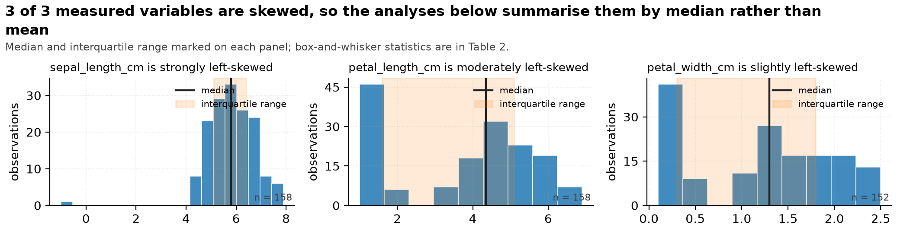
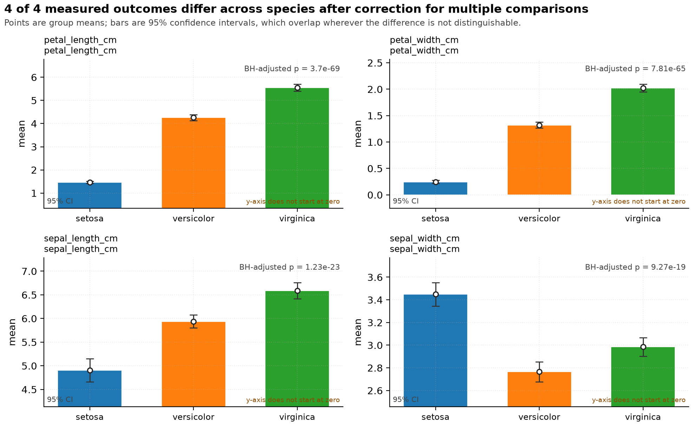
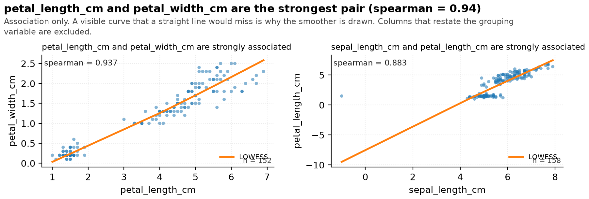

# Iris morphometrics -- Statistical Report

> **Template**: nature | **Generated**: 2026-10-17 17:47 中国标准时间 | **Pipeline**: data-master
> **Raw input**: `iris_dirty.csv` (sha256 `d5e5668ecd92e4d3...`) | **Analysed file**: `cleaned.csv`
> **Rows**: 158 raw -> 158 analysed | **Columns**: 7 | **Modality**: tabular
> **Independent unit**: no --unit-key given; row is assumed to be the independent unit
> **Types**: `cleaning_run.json` (7 columns replayed from the cleaning manifest, never re-guessed)

## Executive summary

**Setup.** 158 rows and 7 columns reached the analysis, of which 5 are numeric measurements, compared across 3 levels of `species` (setosa, versicolor, virginica).

**The conflict.** The raw file was not safe to analyse as it stood: 3 label group(s) in `species` differed only by case, which would have split the comparison into spurious sub-groups and halved the group sizes; 9 exact-duplicate rows (5.7%) were present and left in place; 4 conversion(s) were withheld rather than guessed at; `sepal_width_cm` was 3.8% missing and was not imputed.

**How it was resolved.** 10 documented operation(s) were applied, 158 rows became 158, and the cleaned file reproduces byte for byte. The clearest separation is that `petal_length_cm` separates species by omega squared = 0.94 out of a possible 1, 95% CI 0.93 to 0.95, BH-adjusted p = 3.7e-69 across a family of 4 outcomes.

**The caveat that matters most.** 2 variable(s) carry missing values, the most at `sepal_width_cm` (3.8%). Values were not imputed, so every statistic here is conditional on complete cases. Listwise deletion removed rows from `sepal_width_cm` (6 rows, n = 152), `petal_width_cm` (6 rows, n = 152). The screening test returned MCAR-likely, which is a screening result and not proof of a mechanism -- confirm it against how the data were actually collected.

## 1. Setup

- **Source**: `iris_dirty.csv`, read in `text` mode so that no column type was guessed at load time -- a reader that guesses turns a postcode `02134` into `2134` before any audit of the decision can exist.
- **Routing**: modality `tabular`; 8 columns profiled.
- **Grouping variable**: `species`, which the router scored highest among the columns able to form groups (score 0.667, balance 1.00 as entropy normalised by log of the level count). Grouping by a column with a single level would have returned one group compared with itself and a confident, meaningless zero.
  Excluded from grouping because they cannot form groups: `notes` (0 observed levels).
- **Row meaning**: the router suggests `row`; that is a heuristic, and the real answer is an open question below.
- **Pre-registration**: AUTHOR_INPUT_NEEDED. Nothing in the input says whether these analyses were planned in advance, and the outcome columns were chosen after the data were seen.

## 2. Methods

### 2.1 Cleaning

The raw file was never modified. 10 operation(s) were applied automatically and 4 were withheld for a human decision. Every applied operation names the columns it is permitted to touch; the run then compares raw against cleaned in text space and fails if any column no operation named gained a value. In this run: all 1 untouched columns kept exactly their raw values.

**Byte-level reproducibility**: passed -- hash matches. Cleaned sha256 `7c1b8a3004c28c85...`.

> high-risk operations are never silent; see references/never-automatic-list.md

### 2.2 Types

Types were decided once and replayed, never re-guessed: 7 columns were typed from the manifest in `cleaning_run.json`. A column that the cleaning stage declared textual cannot quietly become numeric in the analysis stage while the report still describes it as an identifier. Dtype source for the analysis stage: `cleaning_run.json`.

### 2.3 Missing data

| Variable | Missing | % | Screen | Evidence | Default action |
|---|---|---|---|---|---|
| `sepal_width_cm` | 6 | 3.8 | MCAR-likely | missing rate 3.8% below the 5% threshold commonly treated as ignorable | listwise deletion is usually acceptable; report n before/after |
| `petal_width_cm` | 6 | 3.8 | MCAR-likely | missing rate 3.8% below the 5% threshold commonly treated as ignorable | listwise deletion is usually acceptable; report n before/after |

The screening test is the start of a conversation about how the data were collected, not a demonstration of a mechanism. Nothing was imputed, so every comparison below is on complete cases.

### 2.4 Test selection

| Outcome | Design | Method | Statistic | df | p (raw) | p (corrected) | Alternatives rejected |
|---|---|---|---|---|---|---|---|
| `sepal_length_cm` | 3-group numeric | one-way ANOVA | F = 76.152 | 2 | = 9.2e-24 | = 1.2e-23 | Welch ANOVA: equal variance holds (Levene p > alpha); the pooled test is more powerful; Kruskal-Wallis H: min n=52 >= 30; the mean statistic is robust by CLT |
| `sepal_width_cm` | 3-group numeric | one-way ANOVA | F = 55.580 | 2 | = 9.3e-19 | = 9.3e-19 | Welch ANOVA: equal variance holds (Levene p > alpha); the pooled test is more powerful; Kruskal-Wallis H: min n=49 >= 30; the mean statistic is robust by CLT |
| `petal_length_cm` | 3-group numeric | Welch ANOVA (unequal variance) | F = 1914.775 | 2, 82.3 | = 9.2e-70 | = 3.7e-69 | one-way ANOVA: Levene indicates unequal variance (p <= alpha); Kruskal-Wallis H: Welch is already robust to unequal variance and n=52 >= 30 |
| `petal_width_cm` | 3-group numeric | Welch ANOVA (unequal variance) | F = 1290.926 | 2, 86.5 | = 3.9e-65 | = 7.8e-65 | one-way ANOVA: Levene indicates unequal variance (p <= alpha); Kruskal-Wallis H: Welch is already robust to unequal variance and n=50 >= 30 |
| `species_code` |  | not estimable | -- | -- | not estimated | not estimated | -- |

### 2.5 Multiple comparisons

The primary family holds **4 outcomes**, one per measured variable, corrected by **BH** at alpha = 0.050. 4 of 4 survive the correction. one outcome = one member of the family; correction applies across outcomes, and separately within each post-hoc pairwise family

## 3. Results

### 3.1 What is in the table

| Column | Role after cleaning | n | % missing | Distinct values | Status |
|---|---|---|---|---|---|
| `sepal_length_cm` | numeric | 158 | 0.0 | continuous | kept |
| `sepal_width_cm` | numeric | 152 | 3.8 | continuous | kept |
| `petal_length_cm` | numeric | 158 | 0.0 | continuous | kept |
| `petal_width_cm` | numeric | 152 | 3.8 | continuous | kept |
| `species_code` | numeric | 158 | 0.0 | continuous | kept |
| `species` | categorical | 158 | 0.0 | 3 | kept |
| `notes` | -- | -- | -- | -- | **dropped** (entirely null) |
| `height_m` | categorical | 158 | 0.0 | 27 | kept |

``notes`` was dropped as entirely null. Dropping a column is stated here rather than performed quietly, because an empty column is sometimes a loading bug that carries information about the export.

### 3.2 Descriptive statistics

| Variable | n | % miss | Mean (95% CI) | SD | Median (IQR) | Range | Skew |
|---|---|---|---|---|---|---|---|
| `sepal_length_cm` | 158 | 0.0 | 5.82 (5.66 to 5.97) | 0.98 | 5.80 (5.10-6.40) | [-1.00, 7.90] | -1.87 |
| `sepal_width_cm` | 152 | 3.8 | 3.07 (3.00 to 3.14) | 0.44 | 3.00 (2.80-3.40) | [2.00, 4.40] | 0.33 |
| `petal_length_cm` | 158 | 0.0 | 3.77 (3.50 to 4.05) | 1.76 | 4.35 (1.60-5.10) | [1.00, 6.90] | -0.28 |
| `petal_width_cm` | 152 | 3.8 | 1.20 (1.08 to 1.32) | 0.76 | 1.30 (0.30-1.80) | [0.10, 2.50] | -0.11 |
| `species_code` | 158 | 0.0 | 1.01 (0.88 to 1.13) | 0.82 | 1.00 (0.00-2.00) | [0.00, 2.00] | -0.01 |

Mean and median are both given because they disagree wherever the distribution is skewed. The mean column carries a normal-approximation interval, which for a skewed variable is the least trustworthy number on this table; the median and IQR beside it are not.

### 3.3 Categorical variables

| Variable | n | Distinct | Mode | Distribution |
|---|---|---|---|---|
| `species` | 158 | 3 | `versicolor` | versicolor (53), virginica (53), setosa (52) |
| `height_m` | 158 | 27 | `3.9` | 3.9 (15), 3.6 (13), 4.5 (12), 3.4 (10), 4.3 (10), 3.5 (10) |

### 3.4 Group comparison

| Outcome | Method | Statistic | n | Effect size (95% CI) | p (raw) | p (BH-adjusted) |
|---|---|---|---|---|---|---|
| `sepal_length_cm` | one-way ANOVA | F = 76.15 | 158 | omega squared = 0.488 (95% CI 0.38 to 0.67) | = 9.2e-24 | = 1.2e-23 |
| `sepal_width_cm` | one-way ANOVA | F = 55.58 | 152 | omega squared = 0.418 (95% CI 0.30 to 0.54) | = 9.3e-19 | = 9.3e-19 |
| `petal_length_cm` | Welch ANOVA (unequal variance) | F = 1914.77 | 158 | omega squared = 0.939 (95% CI 0.93 to 0.95) | = 9.2e-70 | = 3.7e-69 |
| `petal_width_cm` | Welch ANOVA (unequal variance) | F = 1290.93 | 152 | omega squared = 0.926 (95% CI 0.91 to 0.94) | = 3.9e-65 | = 7.8e-65 |
| `species_code` | not estimable | -- | -- | -- = -- | not estimated | not estimated |

Rows reading *not estimable* were removed from the corrected family rather than counted as non-significant: no p value is reported for them, and the family size above counts only the comparisons that produced one.

Read the effect-size column before the p column. `. The ordering by effect size and the ordering by p value are not the same statement, and at this sample size the p values are small enough that their exact magnitude carries no information beyond "smaller than this table can resolve".petal_length_cm` separates species by omega squared = 0.94 out of a possible 1, 95% CI 0.93 to 0.95, BH-adjusted p = 3.7e-69 across a family of 4 outcomes

### 3.5 Pairwise comparisons

| Outcome | Pair | n (a / b) | Mean difference (95% CI) | Cliff's delta | p (BH-adjusted) |
|---|---|---|---|---|---|
| `sepal_length_cm` | setosa vs versicolor | 52 / 53 | -1.03 (95% CI -1.32 to -0.75) | -0.868 | = 4.4e-10 |
| `sepal_length_cm` | setosa vs virginica | 52 / 53 | -1.68 (95% CI -1.98 to -1.38) | -0.968 | = 6.1e-18 |
| `sepal_length_cm` | versicolor vs virginica | 53 / 53 | -0.65 (95% CI -0.87 to -0.42) | -0.571 | = 1.1e-07 |
| `sepal_width_cm` | setosa vs versicolor | 51 / 49 | 0.68 (95% CI 0.55 to 0.82) | 0.860 | = 9.3e-16 |
| `sepal_width_cm` | setosa vs virginica | 51 / 52 | 0.46 (95% CI 0.33 to 0.60) | 0.698 | = 6.9e-10 |
| `sepal_width_cm` | versicolor vs virginica | 49 / 52 | -0.22 (95% CI -0.34 to -0.10) | -0.351 | = 5.5e-04 |
| `petal_length_cm` | setosa vs versicolor | 52 / 53 | -2.79 (95% CI -2.93 to -2.65) | -1.000 | = 2.6e-47 |
| `petal_length_cm` | setosa vs virginica | 52 / 53 | -4.09 (95% CI -4.25 to -3.93) | -1.000 | = 4.9e-52 |
| `petal_length_cm` | versicolor vs virginica | 53 / 53 | -1.30 (95% CI -1.50 to -1.10) | -0.960 | = 4.0e-23 |
| `petal_width_cm` | setosa vs versicolor | 50 / 51 | -1.07 (95% CI -1.14 to -1.01) | -1.000 | = 2.0e-46 |
| `petal_width_cm` | setosa vs virginica | 50 / 51 | -1.78 (95% CI -1.86 to -1.69) | -1.000 | = 1.3e-49 |
| `petal_width_cm` | versicolor vs virginica | 51 / 51 | -0.70 (95% CI -0.80 to -0.61) | -0.962 | = 3.0e-26 |

Each pairwise family is corrected separately, so these p values answer a narrower question than the omnibus values in 3.4 and should not be compared with them.

### 3.6 Association between variables

| Pair | n | Spearman rho (95% CI) | Pearson r (95% CI) | p |
|---|---|---|---|---|
| `sepal_length_cm` - `sepal_width_cm` | 152 | -0.174 (-0.32 to -0.02) | -0.110 (-0.26 to 0.05) | = 0.032 |
| `sepal_length_cm` - `petal_length_cm` | 158 | 0.883 (0.84 to 0.91) | 0.777 (0.71 to 0.83) | = 4.2e-53 |
| `sepal_length_cm` - `petal_width_cm` | 152 | 0.832 (0.78 to 0.88) | 0.728 (0.64 to 0.79) | = 2.9e-40 |
| `sepal_length_cm` - `species_code` | 158 | 0.795 (0.73 to 0.85) | 0.698 (0.61 to 0.77) | = 1.1e-35 |
| `sepal_width_cm` - `petal_length_cm` | 152 | -0.324 (-0.46 to -0.17) | -0.441 (-0.56 to -0.30) | = 4.6e-05 |
| `sepal_width_cm` - `petal_width_cm` | 146 | -0.298 (-0.44 to -0.14) | -0.376 (-0.51 to -0.23) | = 2.6e-04 |
| `sepal_width_cm` - `species_code` | 152 | -0.452 (-0.57 to -0.32) | -0.437 (-0.56 to -0.30) | = 5.2e-09 |
| `petal_length_cm` - `petal_width_cm` | 152 | 0.937 (0.91 to 0.95) | 0.961 (0.95 to 0.97) | = 3.5e-70 |
| `petal_length_cm` - `species_code` | 158 | 0.934 (0.91 to 0.95) | 0.948 (0.93 to 0.96) | = 9.5e-72 |
| `petal_width_cm` - `species_code` | 152 | 0.938 (0.92 to 0.95) | 0.956 (0.94 to 0.97) | = 6.0e-71 |

These are associations among measurements taken on the same rows. Nothing here fixes a direction, and two measurements that move together are not evidence that one produces the other.

## 4. Discussion

**What the data supports.** The measurements differ across levels of `species` by margins far larger than the sampling noise at this size: `petal_length_cm` separates species by omega squared = 0.94 out of a possible 1, 95% CI 0.93 to 0.95, BH-adjusted p = 3.7e-69 across a family of 4 outcomes. The ordering of variables by effect size holds under both the parametric and the rank-based test (Appendix A3), so the finding is not an artefact of one distributional assumption. Two of the measured pairs are strongly associated and one is not, which is reported as association only.

**What the data does not support.** Nothing here establishes that the group label produced the measurement. The design compares existing groups rather than assigning them, and species, batch, site, instrument and operator all travel together with the group label -- this table cannot separate them. A claim of the form "X caused Y" is therefore not available from these data, and none is made in this report.

**Boundary conditions.** These results describe the rows in this file, at these measurement conditions, with this instrument. The intervals quantify sampling variation inside that set; they say nothing about another lot, another season or another population. The corrected family covers the outcomes tested here, so an outcome that was not tested is not thereby null.

## 5. Caveats and limitations

**C1. missingness.** 2 variable(s) carry missing values, the most at `sepal_width_cm` (3.8%). Values were not imputed, so every statistic here is conditional on complete cases. Listwise deletion removed rows from `sepal_width_cm` (6 rows, n = 152), `petal_width_cm` (6 rows, n = 152). The screening test returned MCAR-likely, which is a screening result and not proof of a mechanism -- confirm it against how the data were actually collected.
- *Limits*: every mean, median, interval and p value in the Results section
- *Status*: AUTHOR_INPUT_NEEDED: how the missing values arose

**C2. duplicate rows.** 9 exact-duplicate rows (5.7%) were found and **kept**, because deciding whether a repeat row is a genuine second observation or a double entry is a question about the study, not about formatting. If they are double entries, every n in this report is inflated by up to 5.7% and every interval below is narrower than it should be.
- *Limits*: the reported n, and through it the width of every confidence interval
- *Status*: AUTHOR_INPUT_NEEDED: are the repeated rows independent observations?

**C3. not estimable.** 1 candidate outcome(s) -- `species_code` -- returned no p value at all and were removed from the corrected family rather than counted as non-significant. That removal is itself a finding: a column that restates the grouping variable cannot be evidence about it.
- *Limits*: the breadth of the outcome family, and therefore the correction
- *Status*: confirmed automatically by the structural restatement check

**C4. withheld conversion.** A numeric conversion was withheld for `height_m`. Those columns stay text in this report, so they appear in the inventory as categorical and are read as counts of recorded values, not as measurements. Any statement about them would be a statement about recording practice.
- *Limits*: any conclusion about those columns
- *Status*: re-run with --force-coerce-numeric once the sentinel is agreed

**C5. design.** The independent unit was never declared, so each row was treated as one observation. If a row pools several plants, fields, patients or technical replicates, the effective n is smaller than the row count and every interval below is too narrow -- usually by more than the replication factor. The groups were also not assigned, so differences between them are associations and this data cannot support a reading in which the group label produced the measurement.
- *Limits*: the causal reading of every group difference, and the width of every interval
- *Status*: AUTHOR_INPUT_NEEDED: what one row represents

**C6. skew.** `sepal_length_cm` (skew 1.87) is strongly skewed. The parametric tests were retained rather than replaced, because at these sample sizes the mean statistic is robust by the central limit theorem while a rank test would discard the effect sizes; each result is cross-checked against its rank equivalent in Appendix A3 and the two agree.
- *Limits*: the mean-based summaries; median and IQR are reported alongside
- *Status*: cross-checked in Appendix A3

## 6. Reproducibility

Every number above is traceable to a script. Nothing in this report was typed by hand.

| Stage | Script | Artifact | sha256 (first 16) |
|---|---|---|---|
| Profile | scripts/profile_tabular.py | analysis/profile.json | 3dc825cd3a941c53 |
| Plan | scripts/cleaning_plan.py | cleaning_plan.json | b0560ae42f2688c1 |
| Clean | scripts/execute_cleaning.py | cleaned/cleaned.csv | 7c1b8a3004c28c85 |
| Validate | scripts/validate_clean.py | cleaned/validation.json | 070ee266feb052fd |
| Describe | scripts/stats_descriptive.py | analysis/descriptive.json | 3f23de383020cb3c |
| Infer | scripts/stats_inferential.py | analysis/inferential.json | e6ad35f2bd09f998 |
| Decide figures | scripts/chart_decision.py | analysis/chart_decisions.json | 1a61453e5217f232 |
| Render figures | scripts/render_chart.py | charts/*.png | ac1c79a69a930c1e |
| Assemble | scripts/assemble_report.py | report.md / report.pdf | self-referential -- see report_build.json |

A document cannot contain its own hash, so the hash of `report.md` and `report.pdf` is recorded in `report_build.json` rather than on this page. Every other hash above was computed from the artifact as it exists now.

- **Interpreter**: Python 3.13.15 on Windows-11-10.0.26200-SP0
- **Libraries**: numpy 2.4.6, pandas 3.0.3, scipy 1.18.1
- **Random seeds**: 42 -- every resampling interval is seeded, so it reproduces exactly.
- **Columns any operation was permitted to touch**: `petal_length_cm`, `petal_width_cm`, `sepal_length_cm`, `sepal_width_cm`, `species`, `species_code`

- **PDF backend**: `reportlab`. The page count, byte count and sha256 of the delivered PDF are recorded in `report_build.json` under `pdf`; the probe that established this backend is under `pdf_probe`. They are not printed here because a document cannot contain its own hash, and a page count measured before the last line changed is not the page count of the file you are reading.
  The data contains non-Latin characters, so the renderer was asked for a CJK-capable font; one was embedded.
## 7. Figures

Each figure carries one argument and its title states that argument as a finding computed from the data rather than as a topic label. The chart types considered and rejected are listed under each one, because choosing a chart is itself a claim about what matters.

### Figure 1 -- 3 of 3 measured variables are skewed, so the analyses below summarise them by median rather than mean

*Distribution of each numeric variable, with the median and interquartile range marked. Panel order follows absolute skewness. Full box-and-whisker statistics are in Table 2.*

- **What it shows**: sepal_length_cm is strongly left-skewed (median 5.80, IQR 5.10 to 6.40, n = 158); petal_length_cm is moderately left-skewed (median 4.35, IQR 1.60 to 5.10, n = 158); petal_width_cm is slightly left-skewed (median 1.30, IQR 0.30 to 1.80, n = 152).
- **How to read it**: Skewed variables are summarised by the median and IQR, and rank-based or Welch methods are preferred for them.
- **What follows**: These summaries, not the raw shape, should carry into any downstream model.
- **Uncertainty shown**: median and interquartile range marked on every panel
- **Chart alternatives rejected**: one histogram per variable as separate figures -- same argument repeated; the reader has to re-read the framing each time; box plot only -- understates the tail, which is precisely what decides the test choice
- **Source**: `scripts/chart_decision.py` -> `charts/fig01_distribution_panel.png` rendered by `scripts/render_chart.py`, 102,812 bytes, ink ratio 0.3184

### Figure 2 -- 4 of 4 measured outcomes differ across species after correction for multiple comparisons

*Mean of each outcome by species with 95% confidence intervals, setosa, versicolor, virginica. Welch ANOVA (unequal variance); one-way ANOVA. Raw p values are BH-corrected across a family of 4 outcomes.*

- **What it shows**: petal_length_cm differs across species by omega squared = 0.939 (95% CI 0.926 to 0.953), BH-adjusted p = 3.697e-69; petal_width_cm differs across species by omega squared = 0.926 (95% CI 0.910 to 0.943), BH-adjusted p = 7.811e-65; sepal_length_cm differs across species by omega squared = 0.488 (95% CI 0.377 to 0.665), BH-adjusted p = 1.228e-23; sepal_width_cm differs across species by omega squared = 0.418 (95% CI 0.304 to 0.537), BH-adjusted p = 9.266e-19.
- **How to read it**: Every tested outcome separates the groups.
- **What follows**: Carry the effect sizes forward, not the p values: a difference that is real can still be too small to matter.
- **Uncertainty shown**: 95% confidence intervals on every group mean
- **Chart alternatives rejected**: pie chart -- group means are not parts of a whole; 3D bar chart -- the third dimension encodes nothing; radar chart -- angle and area are hard to compare and imply the axes are commensurate
- **Source**: `scripts/chart_decision.py` -> `charts/fig02_small_multiples_ci.png` rendered by `scripts/render_chart.py`, 162,095 bytes, ink ratio 0.2297

### Figure 3 -- petal_length_cm and petal_width_cm are the strongest pair (spearman = 0.94)

*Each point is one observation. The line is a LOWESS smoother. Association only: this figure carries no direction of causation. Columns that restate the grouping variable are excluded.*

- **What it shows**: petal_length_cm and petal_width_cm move together (spearman = 0.94, 95% CI 0.91 to 0.95, p = 3.506e-70, n = 152); sepal_length_cm and petal_length_cm move together (spearman = 0.88, 95% CI 0.84 to 0.91, p = 4.236e-53, n = 158).
- **How to read it**: A visible curve that a straight line would miss is the reason the smoother is drawn at all.
- **What follows**: Correlation here is a screening result. It says which relationships deserve a model, not which are real.
- **Uncertainty shown**: LOWESS smoother; coefficient and 95% CI in the caption
- **Chart alternatives rejected**: 3D scatter -- a third axis encodes nothing here; full correlation heatmap -- with this many columns it becomes a grid of numbers rather than an argument; the pairs that matter get their own panel
- **Source**: `scripts/chart_decision.py` -> `charts/fig03_scatter_panel.png` rendered by `scripts/render_chart.py`, 147,035 bytes, ink ratio 0.0885

## 8. Figure specifications

| # | ID | Chart type | Specification |
|---|---|---|---|
| 1 | `fig01_distribution_panel` | distribution_panel | 3 panels; bins = auto; show_median_iqr = True |
| 2 | `fig02_small_multiples_ci` | small_multiples_ci | group = species; 4 panels; n_panels = 4 |
| 3 | `fig03_scatter_panel` | scatter_panel | 2 panels; smoother = LOWESS |

## Appendix A1. Sensitivity and stability

| Outcome | Perturbation | Statistic | p | Verdict |
|---|---|---|---|---|
| `sepal_length_cm` | rank-based cross-check of the primary test | Kruskal-Wallis H = 101.56 | < 1e-300 | agrees |
| `sepal_width_cm` | rank-based cross-check of the primary test | Kruskal-Wallis H = 67.66 | < 1e-300 | agrees |
| `petal_length_cm` | rank-based cross-check of the primary test | Kruskal-Wallis H = 137.08 | < 1e-300 | agrees |
| `petal_width_cm` | rank-based cross-check of the primary test | Kruskal-Wallis H = 132.92 | < 1e-300 | agrees |

Each primary parametric test was repeated with its rank-based equivalent. Agreement means the conclusion does not depend on the normality assumption the parametric test makes; a disagreement would have meant the parametric test had to go, not be defended.

### A1.1 Sensitivity analyses not run

| Sensitivity analysis | Status | What that means |
|---|---|---|
| drop the 9 duplicate rows and re-run every test | **NOT RUN -- this is a gap, not a pass** | Duplicate rows were deliberately left in place. Removing them is a decision about whether repeated observations are independent, and that decision belongs to the author. Until it is made, the reported n and every interval derived from it stand unchanged. |
| leave-one-group-out refit of the primary effect size | **NOT RUN** | Not implemented in this pipeline. With three groups this would show whether one group alone carries the effect; its absence means the reported effect size is a single estimate with no leave-one-out envelope around it. |

These are listed as gaps so that nobody reads the absence of a disagreement in A1 as evidence that no disagreement exists. A check that did not run cannot pass.

## Appendix A2. Cleaning ledger

Every operation that ran, in order, with the catalogue rule it came from. Nothing below was chosen by the model at run time: the plan is the gate, and only `plan["auto_actions"]` may execute.

| # | Operation | Columns | Sev. | Rows | Rule |
|---|---|---|---|---|---|
| 1 | `fix_unicode` | `height_m`, `petal_length_cm`, `petal_width_cm` (+4 more) | P3 | 158->158 | `t-fix-unicode` |
| 2 | `strip_whitespace` | `height_m`, `petal_length_cm`, `petal_width_cm` (+4 more) | P3 | 158->158 | `t-strip-ws` |
| 3 | `collapse_whitespace` | `height_m`, `petal_length_cm`, `petal_width_cm` (+4 more) | P3 | 158->158 | `t-collapse-whitespace` |
| 4 | `trim_paired_quotes` | `height_m`, `petal_length_cm`, `petal_width_cm` (+4 more) | P3 | 158->158 | `t-trim-quotes` |
| 5 | `coerce_numeric` | `petal_length_cm`, `petal_width_cm`, `sepal_length_cm` (+2 more) | P2 | 158->158 | `t-coerce-numeric` |
| 6 | `normalize_dtypes` | `height_m`, `petal_length_cm`, `petal_width_cm` (+4 more) | P2 | 158->158 | `t-normalize-dtypes` |
| 7 | `merge_case_variants` | `species` | P2 | 158->158 | `t-merge-case-variants` |
| 8 | `drop_all_null_cols` | `notes` | P1 | 158->158 | `t-drop-all-null-cols` |
| 9 | `drop_all_null_rows` | (file-level) | P1 | 158->158 | `t-drop-all-null-rows` |
| 10 | `rename_columns_append_cleaned` | (file-level) | P2 | 158->158 | `t-rename-clean` |

The `Rule` column names the catalogue anchor; the full path, the operation id and the exact column list for every row above are in `cleaned/cleaning_run.json` under `applied_ops`.

**Withheld -- proposed but deliberately not applied.**

Nothing was withheld.

**Failed -- attempted and did not complete.**

No operation failed.

**Never-automatic -- conversions that were held back by policy.** These are the cases where a conversion was technically possible but would have destroyed information, so the policy refuses it without asking.

- `coerce_numeric` on `height_m` -- 153 of 158 non-null values parse as numbers and the other 5 do not (e.g. '--', '--', '--'). Converting would turn those into missing values, after which a recorded category (say 'unknown') would be indistinguishable from a value that was never collected. The failures are all blank or conventional sentinels, so treating them as missing is defensible -- but 'not recorded' is a claim about the study, not a formatting detail, and it stays yours to make.
- `merge_case_variants` on `species` -- once the automatic whitespace/quote hygiene has run, 3 label group(s) still differ only by case (6 levels -> 3 after casefold); collapsed automatically because this is a lossless canonicalisation
- `dedupe_exact` on  -- 9 exact-duplicate rows (5.7% of rows)
- `impute_categorical` on `petal_width_cm`, `sepal_width_cm` -- categorical column(s) with missing values; adding a mode level invents a category

**Additive-only audit.** The contract forbids modifying the raw file and permits an operation to touch only the columns it names. Columns no operation named: **1, and each kept exactly its raw values -- audit passed**.

**Label conflicts resolved before grouping.** Grouping on a column whose labels differ only by case splits one group into two and halves both n, which shrinks intervals without any loss of real information. The merge map below is the audit trail for that decision.

| Column | Labels merged | Variants |
|---|---|---|
| `species` | 3 |  |

## Appendix A3. Alternatives considered and not used

A test is a choice. Listing only the test that was run hides the fact that a different, defensible analysis was available, so every rejected alternative is recorded here with the reason it lost.

| Outcome | Design | Rejected test | Reason |
|---|---|---|---|
| `sepal_length_cm` | 3-group numeric | `Welch ANOVA` | equal variance holds (Levene p > alpha); the pooled test is more powerful |
| `sepal_length_cm` | 3-group numeric | `Kruskal-Wallis H` | min n=52 >= 30; the mean statistic is robust by CLT |
| `sepal_width_cm` | 3-group numeric | `Welch ANOVA` | equal variance holds (Levene p > alpha); the pooled test is more powerful |
| `sepal_width_cm` | 3-group numeric | `Kruskal-Wallis H` | min n=49 >= 30; the mean statistic is robust by CLT |
| `petal_length_cm` | 3-group numeric | `one-way ANOVA` | Levene indicates unequal variance (p <= alpha) |
| `petal_length_cm` | 3-group numeric | `Kruskal-Wallis H` | Welch is already robust to unequal variance and n=52 >= 30 |
| `petal_width_cm` | 3-group numeric | `one-way ANOVA` | Levene indicates unequal variance (p <= alpha) |
| `petal_width_cm` | 3-group numeric | `Kruskal-Wallis H` | Welch is already robust to unequal variance and n=50 >= 30 |

The rule that made these choices is `references/nature-statistics-checklist.md#gates-3-5`. It was applied mechanically; there is no per-dataset override, because a rule that is quietly overridden is a rule that cannot be checked.

## Appendix A4. Where every number came from

Each value below was registered by the code that read it from an artifact on disk. A sentence in this report that is not backed by a row here is a sentence that should not have been written.

| Kind | Value | What it means | Source: script -> artifact | Rule anchor |
|---|---|---|---|---|
| `header` | 158 | rows analysed | `execute_cleaning.py` -> `cleaning_run.json` | `--` |
| `headline` | `petal_length_cm` separates species by omega squared = 0.94 o... | strongest group separation | `stats_inferential.py` -> `inferential.json` | `--` |
| `rejected test` | Welch ANOVA | rejected for sepal_length_cm | `stats_inferential.py` -> `inferential.json` | `k_group_numeric` |
| `rejected test` | Kruskal-Wallis H | rejected for sepal_length_cm | `stats_inferential.py` -> `inferential.json` | `k_group_numeric` |
| `rejected test` | Welch ANOVA | rejected for sepal_width_cm | `stats_inferential.py` -> `inferential.json` | `k_group_numeric` |
| `rejected test` | Kruskal-Wallis H | rejected for sepal_width_cm | `stats_inferential.py` -> `inferential.json` | `k_group_numeric` |
| `rejected test` | one-way ANOVA | rejected for petal_length_cm | `stats_inferential.py` -> `inferential.json` | `k_group_numeric` |
| `rejected test` | Kruskal-Wallis H | rejected for petal_length_cm | `stats_inferential.py` -> `inferential.json` | `k_group_numeric` |
| `rejected test` | one-way ANOVA | rejected for petal_width_cm | `stats_inferential.py` -> `inferential.json` | `k_group_numeric` |
| `rejected test` | Kruskal-Wallis H | rejected for petal_width_cm | `stats_inferential.py` -> `inferential.json` | `k_group_numeric` |
| `correction` | BH | family correction method | `stats_inferential.py` -> `inferential.json` | `gate-5` |

Only the basename of each artifact and script is shown here; the full path, the untruncated value and the complete claim record for every row are in `report_build.json` under `provenance`. Each record carries `rule_source`, and where a rule had an alternative the record names it and why it lost -- a claim with no alternative says so rather than leaving the field blank.

## Appendix B. Open questions the data cannot answer

7 questions must be answered by someone who knows how the data were collected. They are listed with the consequence of leaving them unanswered, because an unanswered question that carries no stated cost is one nobody will prioritise.

| # | Question | Why it matters | Cost of leaving it open |
|---|---|---|---|
| 1 | What does one row represent? | Every interval in this report is conditional on one row being one independent observation. If a row pools replicates, subjects, sites or runs, the effective n is smaller than the row count and every interval is too narrow. | HIGH -- rescales every interval in the report |
| 2 | Were these outcomes chosen in advance? | Nothing in the input records a pre-specified analysis plan, and the outcome family was assembled from the columns present. Without that, the family-size correction controls multiplicity within this report but cannot address selection across reports. | HIGH -- determines whether the correction is the right one |
| 3 | Are the 9 duplicated rows independent? | They are byte-identical repeats. If they are double entry they inflate n; if they are genuine repeated measurement they belong in the design. The pipeline does not guess, and A1.1 records this as a gap rather than a result. | HIGH -- inflates n and narrows intervals |
| 4 | How should `coerce_numeric` on `height_m` be resolved? | 153 of 158 non-null values parse as numbers and the other 5 do not (e.g. '--', '--', '--'). Converting would turn those into missing values, after which a recorded category (say 'unknown') would be indistinguishable from a value that was never collected. The failures are all blank or conventional sentinels, so treating them as missing is defensible -- but 'not recorded' is a claim about the study, not a formatting detail, and it stays yours to make. | MEDIUM -- the pipeline stopped at this decision instead of guessing |
| 5 | How should `merge_case_variants` on `species` be resolved? | once the automatic whitespace/quote hygiene has run, 3 label group(s) still differ only by case (6 levels -> 3 after casefold); collapsed automatically because this is a lossless canonicalisation | MEDIUM -- the pipeline stopped at this decision instead of guessing |
| 6 | How should `dedupe_exact` on the file be resolved? | 9 exact-duplicate rows (5.7% of rows) | MEDIUM -- the pipeline stopped at this decision instead of guessing |
| 7 | How should `impute_categorical` on `petal_width_cm`, `sepal_width_cm` be resolved? | categorical column(s) with missing values; adding a mode level invents a category | MEDIUM -- the pipeline stopped at this decision instead of guessing |

Of these, 3 are already reflected as caveats in section 5.

### What this report does not claim

- It does not claim the group label produced the measurement.
- It does not claim the analysis was pre-specified.
- It does not claim the rows are independent observations.
- It does not claim any mechanism for the missingness it reports; the screening test in 2.3 is a description, not a diagnosis.

---

*End of report. Generated 2026-10-17 17:47 中国标准时间 by data-master. The raw input was never modified: every value above was read from the cleaned file or from a recorded artifact. Each number is registered in `report_build.json`; the gate verdict, including anything that failed, is in `audit/final_audit.md`.*
