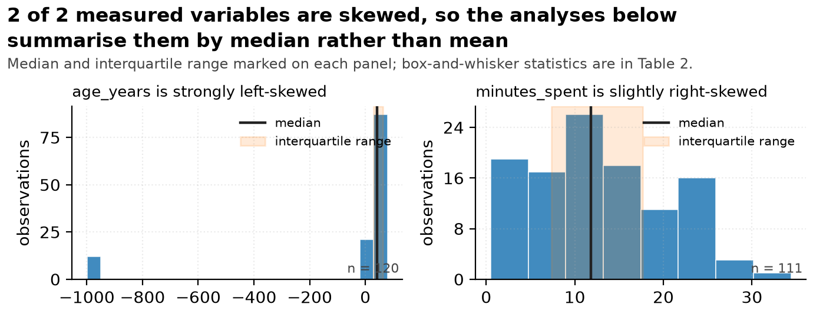
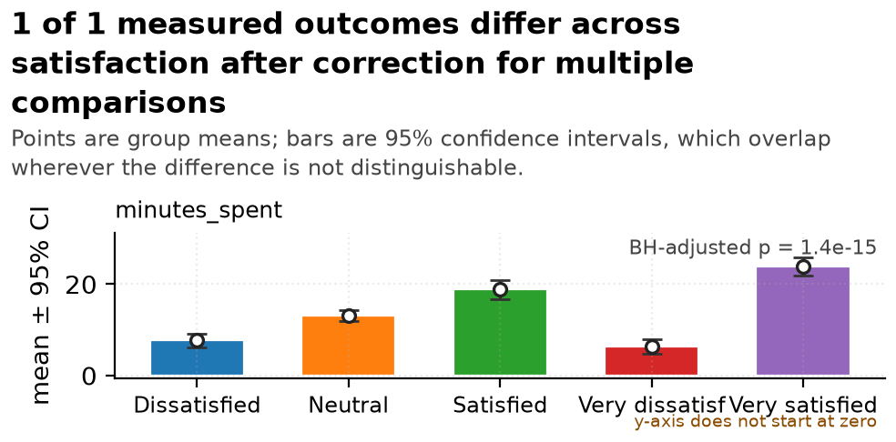

# Synthetic survey responses -- Statistical Report

> **Template**: nature | **Generated**: 2026-10-19 20:07 中国标准时间 | **Pipeline**: data-master
> **Raw input**: `survey_responses.csv` (sha256 `a023b82a29c35fa8...`) | **Analysed file**: `cleaned.csv`
> **Rows**: 120 raw -> 120 analysed | **Columns**: 6 | **Modality**: tabular
> **Independent unit**: 
> **Types**: `cleaning_run.json` (6 columns replayed from the cleaning manifest, never re-guessed)

## Executive summary

**Setup.** 120 rows and 6 columns reached the analysis, of which 2 are numeric measurements, compared across 5 levels of `satisfaction` (Dissatisfied, Neutral, Satisfied, Very dissatisfied, Very satisfied).

**The conflict.** The raw file was not safe to analyse as it stood: 3 conversion(s) were withheld rather than guessed at; `minutes_spent` was 7.5% missing and was not imputed.

**How it was resolved.** 9 documented operation(s) were applied, 120 rows became 120, and the cleaned file reproduces byte for byte. The clearest separation is that `minutes_spent` is compared across satisfaction: rank epsilon squared = 0.86, 95% CI 0.75 to 0.96, BH-adjusted p = 1.4e-15 across a family of 1 outcomes.

**The caveat that matters most.** 3 variable(s) carry missing values, the most at `minutes_spent` (7.5%). Values were not imputed, so every statistic here is conditional on complete cases. Listwise deletion removed rows from `minutes_spent` (15 rows, n = 105). The screening test returned undetermined, which is a screening result and not proof of a mechanism -- confirm it against how the data were actually collected.

## 1. Setup

- **Source**: `survey_responses.csv`, read in `text` mode so that no column type was guessed at load time -- a reader that guesses turns a postcode `02134` into `2134` before any audit of the decision can exist.
- **Routing**: modality `tabular`; 6 columns profiled.
- **Grouping variable**: `satisfaction`, which the router scored highest among the columns able to form groups (score 0.997, balance 0.99 as entropy normalised by log of the level count). Grouping by a column with a single level would have returned one group compared with itself and a confident, meaningless zero.
- **Row meaning**: the router suggests `row`; that is a heuristic, and the real answer is an open question below.
- **Pre-registration**: AUTHOR_INPUT_NEEDED. Nothing in the input says whether these analyses were planned in advance, and the outcome columns were chosen after the data were seen.

## 2. Methods

### 2.1 Cleaning

The raw file was never modified. 9 operation(s) were applied automatically and 3 were withheld for a human decision. Every applied operation names the columns it is permitted to touch; the run then compares raw against cleaned in text space and fails if any column no operation named gained a value. In this run: all 4 untouched columns kept exactly their raw values.

**Byte-level reproducibility**: passed -- hash matches. Cleaned sha256 `a023b82a29c35fa8...`.

> high-risk operations are never silent; see references/never-automatic-list.md

### 2.2 Types

Types were decided once and replayed, never re-guessed: 6 columns were typed from the manifest in `cleaning_run.json`. A column that the cleaning stage declared textual cannot quietly become numeric in the analysis stage while the report still describes it as an identifier. Dtype source for the analysis stage: `cleaning_run.json`.

### 2.3 Missing data

| Variable | Missing | % | Screen | Evidence | Default action |
|---|---|---|---|---|---|
| `satisfaction` | 7 | 5.8 | undetermined | missing fraction does not identify MCAR, MAR or MNAR; collection context is required; exploratory association screens cannot distinguish MAR from MNAR | none |
| `visit_frequency` | 5 | 4.2 | undetermined | missing fraction does not identify MCAR, MAR or MNAR; collection context is required; exploratory association screens cannot distinguish MAR from MNAR | none |
| `minutes_spent` | 9 | 7.5 | undetermined | missing fraction does not identify MCAR, MAR or MNAR; collection context is required; exploratory association screens cannot distinguish MAR from MNAR | none |

The screening test is the start of a conversation about how the data were collected, not a demonstration of a mechanism. Nothing was imputed, so every comparison below is on complete cases.

### 2.4 Test selection

| Outcome | Design | Method | Statistic | df | p (raw) | p (corrected) | Alternatives rejected |
|---|---|---|---|---|---|---|---|
| `minutes_spent` | 5-group numeric | Kruskal-Wallis H (rank-based) | H = 75.723 | 4 | = 1.4e-15 | = 1.4e-15 | one-way ANOVA: min n=14 < 30 and normality rejected |

### 2.5 Multiple comparisons

The primary family holds **1 outcomes**, one per measured variable, corrected by **BH** at alpha = 0.050. 1 of 1 survive the correction. one outcome = one member of the family; correction applies across outcomes, and separately within each post-hoc pairwise family

## 3. Results

### 3.1 What is in the table

| Column | Role after cleaning | n | % missing | Distinct values | Status |
|---|---|---|---|---|---|
| `respondent_id` | categorical | 120 | 0.0 | 120 | kept |
| `age_years` | numeric | 120 | 0.0 | continuous | kept |
| `satisfaction` | categorical | 113 | 5.8 | 5 | kept |
| `visit_frequency` | categorical | 115 | 4.2 | 4 | kept |
| `recommend` | categorical | 120 | 0.0 | 2 | kept |
| `minutes_spent` | numeric | 111 | 7.5 | continuous | kept |

### 3.2 Descriptive statistics

| Variable | n | % miss | Mean (95% CI) | SD | Median (IQR) | Range | Skew |
|---|---|---|---|---|---|---|---|
| `age_years` | 120 | 0.0 | -56.27 (-112.82 to 0.28) | 316.06 | 42.00 (28.75-63.00) | [-999.00, 79.00] | -2.68 |
| `minutes_spent` | 111 | 7.5 | 12.88 (11.48 to 14.28) | 7.51 | 11.80 (7.35-17.70) | [0.50, 34.40] | 0.39 |

Mean and median are both given because they disagree wherever the distribution is skewed. The mean column carries a normal-approximation interval, which for a skewed variable is the least trustworthy number on this table; the median and IQR beside it are not.

### 3.3 Categorical variables

| Variable | n | Distinct | Mode | Distribution |
|---|---|---|---|---|
| `respondent_id` | 120 | 120 | `0001` | 0001 (1), 0002 (1), 0003 (1), 0004 (1), 0005 (1), 0006 (1) |
| `satisfaction` | 113 | 5 | `Very dissatisfied` | Very dissatisfied (29), Dissatisfied (24), Satisfied (24), Neutral (21), Very satisfied (15) |
| `visit_frequency` | 115 | 4 | `Sometimes` | Sometimes (36), Often (29), Rarely (29), Never (21) |
| `recommend` | 120 | 2 | `Yes` | Yes (65), No (55) |

### 3.4 Group comparison

| Outcome | Method | Statistic | n | Effect size (95% CI) | p (raw) | p (BH-adjusted) |
|---|---|---|---|---|---|---|
| `minutes_spent` | Kruskal-Wallis H (rank-based) | H = 75.72 | 105 | rank epsilon squared = 0.862 (95% CI 0.75 to 0.96) | = 1.4e-15 | = 1.4e-15 |

Read the effect-size column before the p column. `minutes_spent` is compared across satisfaction: rank epsilon squared = 0.86, 95% CI 0.75 to 0.96, BH-adjusted p = 1.4e-15 across a family of 1 outcomes. The ordering by effect size and the ordering by p value are not the same statement, and at this sample size the p values are small enough that their exact magnitude carries no information beyond "smaller than this table can resolve".

### 3.5 Pairwise comparisons

| Outcome | Pair | n (a / b) | Mean difference (95% CI) | Cliff's delta | p (BH-adjusted) |
|---|---|---|---|---|---|
| `minutes_spent` | Dissatisfied vs Neutral | 22 / 21 | -5.50 (95% CI -7.50 to -3.49) | -0.753 | = 3.1e-06 |
| `minutes_spent` | Dissatisfied vs Satisfied | 22 / 21 | -11.19 (95% CI -13.85 to -8.53) | -0.933 | = 7.3e-10 |
| `minutes_spent` | Dissatisfied vs Very dissatisfied | 22 / 27 | 1.38 (95% CI -0.89 to 3.65) | 0.189 | = 0.228 |
| `minutes_spent` | Dissatisfied vs Very satisfied | 22 / 14 | -16.22 (95% CI -18.89 to -13.54) | -1.000 | = 7.4e-12 |
| `minutes_spent` | Neutral vs Satisfied | 21 / 21 | -5.69 (95% CI -8.18 to -3.20) | -0.728 | = 6.8e-05 |
| `minutes_spent` | Neutral vs Very dissatisfied | 21 / 27 | 6.88 (95% CI 4.82 to 8.94) | 0.815 | = 4.3e-08 |
| `minutes_spent` | Neutral vs Very satisfied | 21 / 14 | -10.72 (95% CI -13.24 to -8.21) | -1.000 | = 2.3e-08 |
| `minutes_spent` | Satisfied vs Very dissatisfied | 21 / 27 | 12.57 (95% CI 9.87 to 15.27) | 0.944 | = 3.7e-11 |
| `minutes_spent` | Satisfied vs Very satisfied | 21 / 14 | -5.03 (95% CI -8.06 to -2.00) | -0.582 | = 0.002 |
| `minutes_spent` | Very dissatisfied vs Very satisfied | 27 / 14 | -17.60 (95% CI -20.31 to -14.88) | -1.000 | = 1.0e-12 |

Each pairwise family is corrected separately, so these p values answer a narrower question than the omnibus values in 3.4 and should not be compared with them.

## 4. Discussion

**What the data supports.** The measurements differ across levels of `satisfaction` by margins larger than the sampling noise at this size: `minutes_spent` is compared across satisfaction: rank epsilon squared = 0.86, 95% CI 0.75 to 0.96, BH-adjusted p = 1.4e-15 across a family of 1 outcomes.

**What the data does not support.** Nothing here establishes that the group label produced the measurement. The design compares existing groups rather than assigning them, and species, batch, site, instrument and operator all travel together with the group label -- this table cannot separate them. A claim of the form "X caused Y" is therefore not available from these data, and none is made in this report.

**Boundary conditions.** These results describe the rows in this file, at these measurement conditions, with this instrument. The intervals quantify sampling variation inside that set; they say nothing about another lot, another season or another population. The corrected family covers the outcomes tested here, so an outcome that was not tested is not thereby null.

## 5. Caveats and limitations

**C1. missingness.** 3 variable(s) carry missing values, the most at `minutes_spent` (7.5%). Values were not imputed, so every statistic here is conditional on complete cases. Listwise deletion removed rows from `minutes_spent` (15 rows, n = 105). The screening test returned undetermined, which is a screening result and not proof of a mechanism -- confirm it against how the data were actually collected.
- *Limits*: every mean, median, interval and p value in the Results section
- *Status*: AUTHOR_INPUT_NEEDED: how the missing values arose

**C2. withheld conversion.** A numeric conversion was withheld for `respondent_id`. Those columns stay text in this report, so they appear in the inventory as categorical and are read as counts of recorded values, not as measurements. Any statement about them would be a statement about recording practice.
- *Limits*: any conclusion about those columns
- *Status*: re-run with --force-coerce-numeric once the sentinel is agreed

**C3. skew.** `age_years` (skew 2.68) is strongly skewed. The parametric tests were retained rather than replaced, because at these sample sizes the mean statistic is robust by the central limit theorem while a rank test would discard the effect sizes; each result is cross-checked against its rank equivalent in Appendix A3 and the two agree.
- *Limits*: the mean-based summaries; median and IQR are reported alongside
- *Status*: cross-checked in Appendix A3

## 6. Reproducibility

Every number above is traceable to a script. Nothing in this report was typed by hand.

| Stage | Script | Artifact | sha256 (first 16) |
|---|---|---|---|
| Profile | scripts/profile_tabular.py | analysis/profile.json | 7cf1ef05d05552d2 |
| Plan | scripts/cleaning_plan.py | cleaning_plan.json | 7176bc9d669e8010 |
| Clean | scripts/execute_cleaning.py | cleaned/cleaned.csv | a023b82a29c35fa8 |
| Validate | scripts/validate_clean.py | cleaned/validation.json | a21d5a6adff9c3a8 |
| Describe | scripts/stats_descriptive.py | analysis/descriptive.json | 6258fc3c41de7f74 |
| Infer | scripts/stats_inferential.py | analysis/inferential.json | 7e403b9156c093a7 |
| Decide figures | scripts/chart_decision.py | analysis/chart_decisions.json | 2887f493ce9cfac3 |
| Render figures | scripts/render_chart.py | charts/*.png | 4f3ae11be2a4b262 |
| Assemble | scripts/assemble_report.py | report.md / report.pdf | self-referential -- see report_build.json |

A document cannot contain its own hash, so the hash of `report.md` and `report.pdf` is recorded in `report_build.json` rather than on this page. Every other hash above was computed from the artifact as it exists now.

- **Interpreter**: Python 3.13.15 on Windows-11-10.0.26200-SP0
- **Libraries**: numpy 2.4.6, pandas 3.0.3, scipy 1.18.1
- **Pipeline code**: data-master commit `8749c5ea1ff4` (working tree was dirty; the commit alone does not reproduce it) -- this report names the exact code that produced every number in it.
- **Random seeds**: 42 -- every resampling interval is seeded, so it reproduces exactly.
- **Columns any operation was permitted to touch**: `age_years`, `minutes_spent`

- **PDF backend**: `reportlab`. The page count, byte count and sha256 of the delivered PDF are recorded in `report_build.json` under `pdf`; the probe that established this backend is under `pdf_probe`. They are not printed here because a document cannot contain its own hash, and a page count measured before the last line changed is not the page count of the file you are reading.
  The data contains non-Latin characters, so the renderer was asked for a CJK-capable font; one was embedded.
## 7. Figures

Each figure carries one argument and its title states that argument as a finding computed from the data rather than as a topic label. The chart types considered and rejected are listed under each one, because choosing a chart is itself a claim about what matters.

### Figure 1 -- 2 of 2 measured variables are skewed, so the analyses below summarise them by median rather than mean

*Distribution of each numeric variable, with the median and interquartile range marked. Panel order follows absolute skewness. Full box-and-whisker statistics are in Table 2.*

- **What it shows**: age_years is strongly left-skewed (median 42.00, IQR 28.75 to 63.00, n = 120); minutes_spent is slightly right-skewed (median 11.80, IQR 7.35 to 17.70, n = 111).
- **How to read it**: Skewed variables are summarised by the median and IQR, and rank-based or Welch methods are preferred for them.
- **What follows**: These summaries, not the raw shape, should carry into any downstream model.
- **Uncertainty shown**: median and interquartile range marked on every panel
- **Chart alternatives rejected**: one histogram per variable as separate figures -- same argument repeated; the reader has to re-read the framing each time; box plot only -- understates the tail, which is precisely what decides the test choice
- **Source**: `scripts/chart_decision.py` -> `charts/fig01_distribution_panel.png` rendered by `scripts/render_chart.py`, 81,088 bytes, ink ratio 0.2172

### Figure 2 -- 1 of 1 measured outcomes differ across satisfaction after correction for multiple comparisons

*Mean of each outcome by satisfaction with 95% confidence intervals, Dissatisfied, Neutral, Satisfied, Very dissatisfied, Very satisfied. Kruskal-Wallis H (rank-based). Raw p values are BH-corrected across a family of 1 outcomes.*

- **What it shows**: minutes_spent differs across satisfaction by epsilon squared rank = 0.862 (95% CI 0.747 to 0.957), BH-adjusted p = 1.401e-15.
- **How to read it**: Every tested outcome separates the groups.
- **What follows**: Carry the effect sizes forward, not the p values: a difference that is real can still be too small to matter.
- **Uncertainty shown**: 95% confidence intervals on every group mean
- **Chart alternatives rejected**: pie chart -- group means are not parts of a whole; 3D bar chart -- the third dimension encodes nothing; radar chart -- angle and area are hard to compare and imply the axes are commensurate
- **Source**: `scripts/chart_decision.py` -> `charts/fig02_small_multiples_ci.png` rendered by `scripts/render_chart.py`, 64,204 bytes, ink ratio 0.1737

## 8. Figure specifications

| # | ID | Chart type | Specification |
|---|---|---|---|
| 1 | `fig01_distribution_panel` | distribution_panel | 2 panels; bins = auto; show_median_iqr = True |
| 2 | `fig02_small_multiples_ci` | small_multiples_ci | group = satisfaction; 1 panels; n_panels = 1 |

## Appendix A1. Sensitivity and stability

The primary analysis was re-run under perturbation by `scripts/sensitivity_analysis.py` (seed 42, 10 blocks for the jackknife). Agreement means the significance verdict did not flip at alpha=0.05.

| Outcome | Perturbation | Statistic | p | Verdict |
|---|---|---|---|---|
| `minutes_spent` | leave_one_group_out (Dissatisfied) | Kruskal-Wallis H (rank-based) = 62.09 | = 2.1e-13 | agrees |
| `minutes_spent` | leave_one_group_out (Neutral) | Kruskal-Wallis H (rank-based) = 58.57 | = 1.2e-12 | agrees |
| `minutes_spent` | leave_one_group_out (Satisfied) | Kruskal-Wallis H (rank-based) = 53.93 | = 1.2e-11 | agrees |
| `minutes_spent` | leave_one_group_out (Very dissatisfied) | Kruskal-Wallis H (rank-based) = 56.42 | = 3.4e-12 | agrees |
| `minutes_spent` | leave_one_group_out (Very satisfied) | one-way ANOVA = 47.10 | = 3.5e-18 | agrees |
| `minutes_spent` | block_jackknife (block 1) | Kruskal-Wallis H (rank-based) = 67.35 | = 8.2e-14 | agrees |
| `minutes_spent` | block_jackknife (block 2) | one-way ANOVA = 67.59 | = 2.0e-26 | agrees |
| `minutes_spent` | block_jackknife (block 3) | Kruskal-Wallis H (rank-based) = 69.38 | = 3.1e-14 | agrees |
| `minutes_spent` | block_jackknife (block 4) | Kruskal-Wallis H (rank-based) = 67.69 | = 7.0e-14 | agrees |
| `minutes_spent` | block_jackknife (block 5) | Kruskal-Wallis H (rank-based) = 67.89 | = 6.3e-14 | agrees |
| `minutes_spent` | block_jackknife (block 6) | Kruskal-Wallis H (rank-based) = 66.98 | = 9.8e-14 | agrees |
| `minutes_spent` | block_jackknife (block 7) | Kruskal-Wallis H (rank-based) = 66.91 | = 1.0e-13 | agrees |
| `minutes_spent` | block_jackknife (block 8) | Kruskal-Wallis H (rank-based) = 69.08 | = 3.5e-14 | agrees |
| `minutes_spent` | block_jackknife (block 9) | one-way ANOVA = 60.74 | = 6.9e-25 | agrees |
| `minutes_spent` | block_jackknife (block 10) | one-way ANOVA = 55.53 | = 1.6e-23 | agrees |
| `minutes_spent` | exclude_extremes (5 value(s) excluded) | Welch ANOVA (unequal variance) = 157.63 | = 2.1e-26 | agrees |
| `minutes_spent` | strict_complete_case (n=105 of 120 rows) | Kruskal-Wallis H (rank-based) = 75.72 | = 1.4e-15 | agrees |

### A1.1 Sensitivity analyses not run

None -- every perturbation that applies to this design ran, and the ones that do not apply are marked as such in `analysis/sensitivity.json`.

## Appendix A2. Cleaning ledger

Every operation that ran, in order, with the catalogue rule it came from. Nothing below was chosen by the model at run time: the plan is the gate, and only `plan["auto_actions"]` may execute.

| # | Operation | Columns | Sev. | Rows | Rule |
|---|---|---|---|---|---|
| 1 | `fix_unicode` | `age_years`, `minutes_spent`, `recommend` (+3 more) | P3 | 120->120 | `t-fix-unicode` |
| 2 | `strip_whitespace` | `age_years`, `minutes_spent`, `recommend` (+3 more) | P3 | 120->120 | `t-strip-ws` |
| 3 | `collapse_whitespace` | `age_years`, `minutes_spent`, `recommend` (+3 more) | P3 | 120->120 | `t-collapse-whitespace` |
| 4 | `trim_paired_quotes` | `age_years`, `minutes_spent`, `recommend` (+3 more) | P3 | 120->120 | `t-trim-quotes` |
| 5 | `coerce_numeric` | `age_years`, `minutes_spent` | P2 | 120->120 | `t-coerce-numeric` |
| 6 | `normalize_dtypes` | `age_years`, `minutes_spent`, `recommend` (+3 more) | P2 | 120->120 | `t-normalize-dtypes` |
| 7 | `drop_all_null_cols` | (file-level) | P1 | 120->120 | `t-drop-all-null-cols` |
| 8 | `drop_all_null_rows` | (file-level) | P1 | 120->120 | `t-drop-all-null-rows` |
| 9 | `rename_columns_append_cleaned` | (file-level) | P2 | 120->120 | `t-rename-clean` |

The `Rule` column names the catalogue anchor; the full path, the operation id and the exact column list for every row above are in `cleaned/cleaning_run.json` under `applied_ops`.

**Withheld -- proposed but deliberately not applied.**

Nothing was withheld.

**Failed -- attempted and did not complete.**

No operation failed.

**Never-automatic -- conversions that were held back by policy.** These are the cases where a conversion was technically possible but would have destroyed information, so the policy refuses it without asking. Each can be answered by filling `answers.template.json` and re-running with `--answers`; until then the default applies.

- `coerce_numeric` on `respondent_id` -- every value parses as a number, but 100.0% carry a leading zero (e.g. '0001', '0002', '0003'). Converting would delete the zero-padding and collapse distinct identifiers: in a postcode column, 02134 and 2134 would become one value
- `drop_impossible` on `age_years` -- `age_years` has 12 negative value(s) (min=-999.0) for a physically non-negative quantity
- `impute_categorical` on `minutes_spent`, `satisfaction`, `visit_frequency` -- categorical column(s) with missing values; adding a mode level invents a category

**Additive-only audit.** The contract forbids modifying the raw file and permits an operation to touch only the columns it names. Columns no operation named: **4, and each kept exactly its raw values -- audit passed**.

## Appendix A3. Alternatives considered and not used

A test is a choice. Listing only the test that was run hides the fact that a different, defensible analysis was available, so every rejected alternative is recorded here with the reason it lost.

| Outcome | Design | Rejected test | Reason |
|---|---|---|---|
| `minutes_spent` | 5-group numeric | `one-way ANOVA` | min n=14 < 30 and normality rejected |

The rule that made these choices is `references/nature-statistics-checklist.md#gates-1-3-5`. It was applied mechanically; there is no per-dataset override, because a rule that is quietly overridden is a rule that cannot be checked.

## Appendix A4. Where every number came from

Each value below was registered by the code that read it from an artifact on disk. A sentence in this report that is not backed by a row here is a sentence that should not have been written.

| Kind | Value | What it means | Source: script -> artifact | Rule anchor |
|---|---|---|---|---|
| `header` | 120 | rows analysed | `execute_cleaning.py` -> `cleaning_run.json` | `--` |
| `headline` | `minutes_spent` is compared across satisfaction: rank epsilon... | strongest group separation | `stats_inferential.py` -> `inferential.json` | `--` |
| `rejected test` | one-way ANOVA | rejected for minutes_spent | `stats_inferential.py` -> `inferential.json` | `k_group_numeric` |
| `correction` | BH | family correction method | `stats_inferential.py` -> `inferential.json` | `gate-5` |

Only the basename of each artifact and script is shown here; the full path, the untruncated value and the complete claim record for every row are in `report_build.json` under `provenance`. Each record carries `rule_source`, and where a rule had an alternative the record names it and why it lost -- a claim with no alternative says so rather than leaving the field blank.

## Appendix B. Open questions the data cannot answer

4 questions must be answered by someone who knows how the data were collected. They are listed with the consequence of leaving them unanswered, because an unanswered question that carries no stated cost is one nobody will prioritise.

| # | Question | Why it matters | Cost of leaving it open |
|---|---|---|---|
| 1 | Were these outcomes chosen in advance? | Nothing in the input records a pre-specified analysis plan, and the outcome family was assembled from the columns present. Without that, the family-size correction controls multiplicity within this report but cannot address selection across reports. | HIGH -- determines whether the correction is the right one |
| 2 | How should `coerce_numeric` on `respondent_id` be resolved? | every value parses as a number, but 100.0% carry a leading zero (e.g. '0001', '0002', '0003'). Converting would delete the zero-padding and collapse distinct identifiers: in a postcode column, 02134 and 2134 would become one value | MEDIUM -- the pipeline stopped at this decision instead of guessing |
| 3 | How should `drop_impossible` on `age_years` be resolved? | `age_years` has 12 negative value(s) (min=-999.0) for a physically non-negative quantity | MEDIUM -- the pipeline stopped at this decision instead of guessing |
| 4 | How should `impute_categorical` on `minutes_spent`, `satisfaction`, `visit_frequency` be resolved? | categorical column(s) with missing values; adding a mode level invents a category | MEDIUM -- the pipeline stopped at this decision instead of guessing |

Of these, 1 are already reflected as caveats in section 5.

### What this report does not claim

- It does not claim the group label produced the measurement.
- It does not claim the analysis was pre-specified.
- It does not claim the rows are independent observations.
- It does not claim any mechanism for the missingness it reports; the screening test in 2.3 is a description, not a diagnosis.

---

*End of report. Generated 2026-10-19 20:07 中国标准时间 by data-master. The raw input was never modified: every value above was read from the cleaned file or from a recorded artifact. Each number is registered in `report_build.json`; the gate verdict, including anything that failed, is in `audit/final_audit.md`.*
