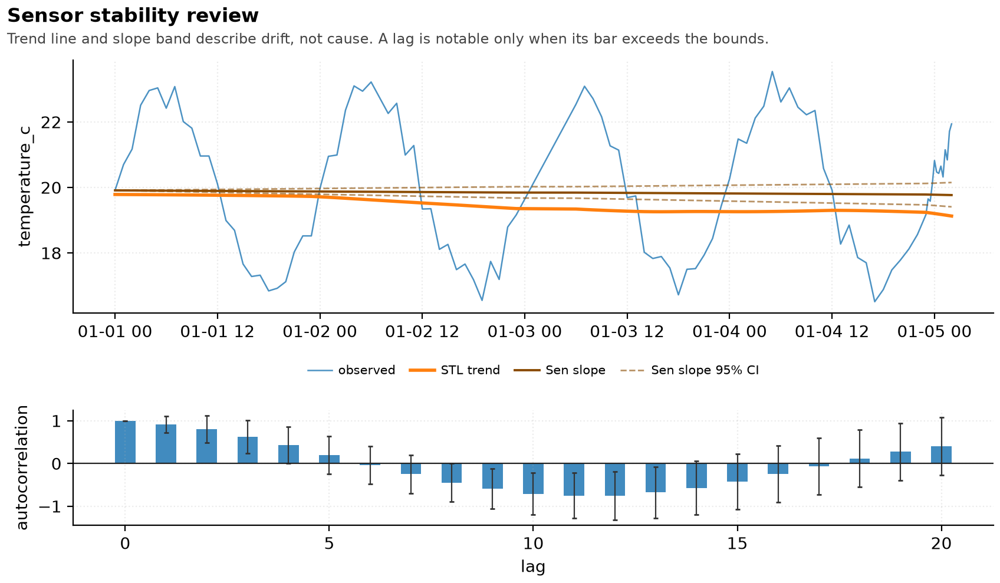

# Sensor stability review

_Profile report with descriptive time-series statistics, generated 2026-10-18 17:39 中国标准时间 by `scripts/assemble_profile_report.py` from the artifacts listed in `report_build.json`. The statistics below are descriptive and screening only -- no forecast, no causal claim._

## Executive summary

The input was routed to 1 branch and profiled without changing the raw files. The profile found **3 anomaly flag(s)**, including **2 at P0/P1**. 
Descriptive time-series statistics were run on `temperature_c` (n=102): no detectable monotone trend; Sen slope -0.00142061 per step (95% CI [-0.0049697, 0.00238095]).
This report describes those findings and stops before forecasting or causal inference because the selected branch does not implement a defensible statistical model for this modality; the statistics above are descriptive, not predictive.

## 1. Scope and routing

The router recorded the following evidence:

| Modality | Files | Profiler | Next stage |
|---|---|---|---|
| `time-series` | 1 | `scripts/profile_timeseries.py` | `cleaning_plan.py` |

Profile-only mode inspects and reports. It does not clean, impute, deduplicate, transform, test or draw inferential conclusions. The time-series statistics in section 2 are an explicitly descriptive exception: trend, autocorrelation, decomposition strength and a changepoint screen.

## 2. Profile findings

### 2.1 time-series

| Field | Value |
|---|---|
| Modality | `time-series` |
| Source | `sensor_log.csv` |
| Records inspected | 103 |
| Fields | 4 |
| Independent-unit hint | one row per timestamp (heuristic, not a declaration) |
| Anomaly flags | 3 |
| Highest severity | P1 |

### Time-series structure

| Property | Observed |
|---|---|
| Time column | `timestamp` |
| Modal interval | 1 hour |
| Regular sampling | no |
| Detected gaps | 14 |
| Regime change suspected | yes |
| First timestamp | 2026-01-01T00:00:00 |
| Last timestamp | 2026-01-05T02:00:00 |

### Numeric series

| Column | n | Missing | Mean | SD | Min | Max |
|---|---|---|---|---|---|---|
| `temperature_c` | 103 | 0 | 19.99 | 2.049 | 16.51 | 23.54 |
| `humidity_pct` | 103 | 0 | 54.91 | 1.897 | 49.6 | 58.4 |

### 2.2 Descriptive time-series statistics

| Statistic | Method | Result |
|---|---|---|
| `mann_kendall` | Mann-Kendall trend test (two-sided, tie-corrected) | S = -244, p = 0.4822954397073186 -- no detectable monotone trend |
| `sen_slope` | Theil-Sen slope, 95% CI | -0.00142061 per step (CI [-0.0049697, 0.00238095]); -30.68517139 per day |
| `stl` | STL decomposition (robust, period=24) | trend strength 0.01202, seasonal strength 0.75704 |
| `changepoint` | CUSUM screen on detrended residuals (permutation null, 500 draws, seed=42) | max|CUSUM| = 11.87487, p = 0.09181636726546906 -- no changepoint detected at alpha=0.05 |

Every p-value above is two-sided at alpha=0.05 with its test name and n recorded in `analysis/timeseries.json`. None of them licenses a forecast or a causal statement.

Autocorrelation: lags exceeding the white-noise bounds are **none** (ACF) and **none** (PACF), out of 20 examined.

## 3. Anomalies

| Branch | Severity | Type | Column | Count | Meaning |
|---|---|---|---|---|---|
| `time-series` | `P1` | `duplicate_timestamps` | -- | 1 | 1 timestamp(s) appear more than once; a mean per instant is not the same as an independent observation per row |
| `time-series` | `P2` | `irregular_gaps` | -- | 14 | the sampling interval is not constant; a mean over rows is then a mean over sampled instants, not over time |
| `time-series` | `P1` | `sampling_regime_change` | -- | -- | the median interval in the last third differs from the first third by more than 3x; check whether the instrument changed |

## 4. What was and was not done

**Completed.** Format routing, bounded decoding, structural profiling, missingness counts, duplicate checks and modality-specific integrity flags. Descriptive time-series statistics (trend, slope with CI, autocorrelation with white-noise bounds, STL strengths, a seeded changepoint screen) with every p-value carrying its test name and n.

**Not performed.** Forecasting and ARIMA-style model fitting on the time series. Statistical inference, causal interpretation, automatic row deletion, imputation, deduplication, feature engineering and model fitting. Their absence is a scope boundary, not a passing result.

## 5. Reproducibility

The run used Python 3.13.15 on Windows-11-10.0.26200-SP0. The profile and route JSON are the evidence for every statement in this report; their hashes and the PDF backend trail are stored in `report_build.json`.

## 6. Open questions

1. **AUTHOR_INPUT_NEEDED: what does one independent unit represent?** The profiler's unit hint is a heuristic based on the input shape, not a study-design declaration.
2. **AUTHOR_INPUT_NEEDED: which anomalies are genuine defects?** Duplicate documents, near-duplicate images, repeated timestamps and coincident points can be either technical repeats or independent observations; the data alone cannot decide.
3. **AUTHOR_INPUT_NEEDED: what comparison or prediction question is the report meant to answer?** A profile can support exploratory decisions but cannot choose a model without a stated estimand.

---

_End of profile-only report. No value in the raw input was modified._
